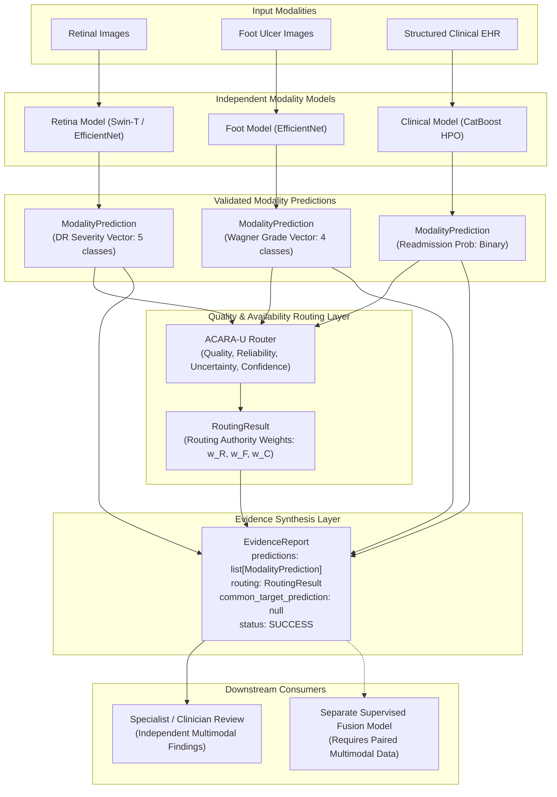
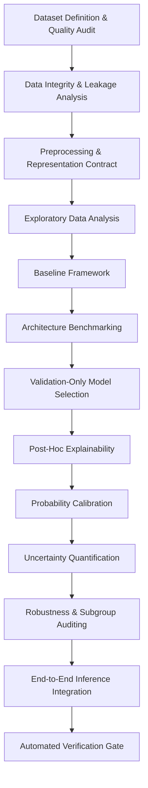
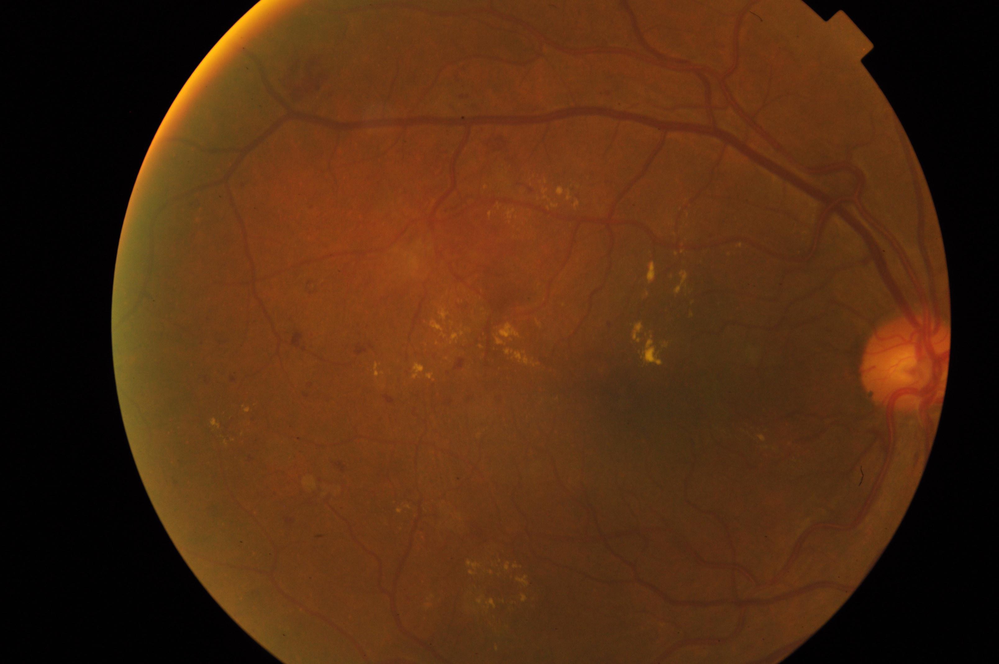
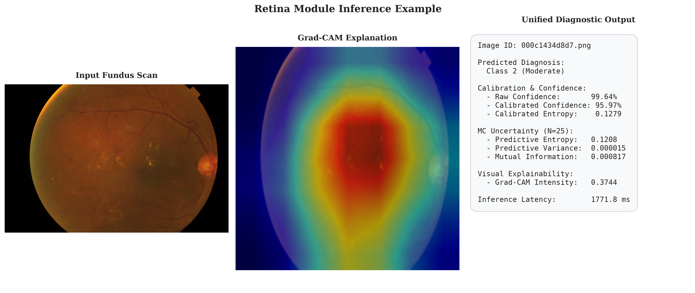
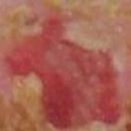
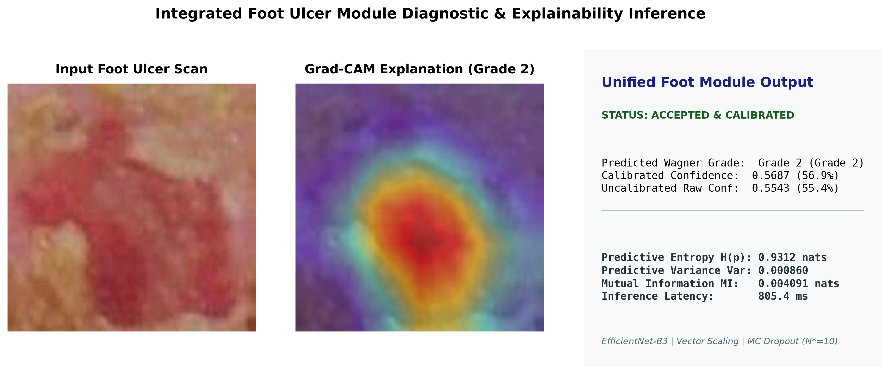
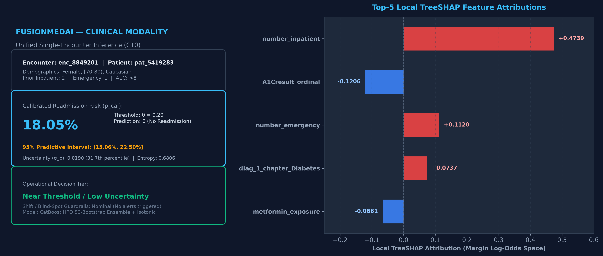

# FusionMedAI

> Research framework for decision-level fusion of independent retinal, diabetic foot-ulcer, and structured clinical prediction models.

[](https://www.python.org/downloads/release/python-3120/)
[](https://pytorch.org/)
[](LICENSE)

---

## Fusion Semantics and Clinical Interpretation

FusionMedAI combines three independently developed prediction systems:
- **Retinal Image Model**: Diabetic retinopathy ordinal severity from retinal fundus photographs ($5$ classes).
- **Foot-Ulcer Image Model**: Wagner-grade wound severity from ulcer photographs ($4$ classes).
- **Structured EHR Model**: 30-day all-cause hospital readmission risk from tabular clinical records ($2$ classes).

These models predict fundamentally different targets, and their outputs **are not measurements of the same clinical quantity**. A weighted average of an ordinal retinal grade, a wound grade, and a 30-day readmission probability does not represent a unified patient risk, a composite adverse outcome probability, or a validated clinical triage acuity.

The active architecture separates three distinct concepts that must not be conflated:

| Layer | Active Contract / Module | Role & Clinical Scope |
| :--- | :--- | :--- |
| **1. Modality Prediction** | `ModalityPrediction` (`retina`, `foot`, `clinical` adapters) | Preserves each model's native clinical target, calibrated distribution, uncertainty, quality provenance, and availability separately. |
| **2. Evidence Routing** | `RoutingResult` / `RouterResult` (`ACARAUv2Router`) | Allocates attention and review-priority weights $w_i$ ($H(w) = -\sum w_i \ln w_i$) across available modalities; does **not** represent clinical outcome probability weights. |
| **3. Unified Risk vs. Historical Benchmark** | `EvidenceReport` (`EvidenceOrchestrator`) vs. `ResearchFusionIndex` (`DCRIEngine`) | Active reports set `common_target_prediction = None` and fail closed (`UnsupportedCommonTargetError`) without a calibrated paired-cohort model. Historical C11 indices ($R_{\mathrm{fusion}}$, $\mathrm{DCRI}$) are isolated as non-clinical research benchmarks. |

A unified patient-risk prediction requires a separately defined outcome and prediction horizon, suitable paired patient-level data, leakage-safe training and evaluation, and independent assessment of discrimination, calibration, uncertainty, and clinical utility. Such validation has not been established by the current controlled decision-packet experiments.

---

## System Architecture: Heterogeneous Evidence Orchestration



---

## Research Questions & Evaluation Framework

### Primary Research Question

> **Can independently evaluated modality-specific prediction models be combined through adaptive decision-level routing that behaves predictably under predictive uncertainty, missing modalities, cross-modality disagreement, and changing modality-combination distributions?**

### Supporting Research Questions

- **RQ1 (Modality Validity)**: Are the three modality-specific models sufficiently characterized in discrimination, calibration, uncertainty, explainability, and robustness to provide standardized inputs to the fusion layer?
- **RQ2 (Adaptive Decision-Level Routing & Parameter Sensitivity)**: Does the ACARA-U scoring kernel ($z_i = \alpha C_i + \beta R_i - \gamma U_i + \eta Q_i$) dynamically allocate decision authority across active channels while strictly preserving the weight simplex, and does the router exhibit stable behavioral dynamics under coefficient perturbations?
- **RQ3 (Missing-Modality Safety)**: Does hard availability masking ($A_i = 0 \implies \tilde{z}_i = -\infty \implies w_i = 0.0$) strictly prevent unavailable modalities from exerting decision authority?
- **RQ4 (Uncertainty-Penalized Aggregation)**: How does additive uncertainty discounting affect the derived decision index $\text{DCRI}_\delta = R_{\text{fusion}} - \delta \sum U_i$ across varying modality counts?
- **RQ5 (Cross-Modality Conflict Quantification)**: Can inter-modality risk divergence be systematically quantified ($\Delta_{\max}, \Delta_{\text{mean}}, \sigma_w$) without treating discordance as clinical synergy or unearned certainty?
- **RQ6 (Modality-Combination Robustness)**: Does routing remain behaviorally well-defined when modality-combination frequencies shift from balanced (D1) to moderate (D2) and strong-tail (D3) controlled distributions?
- **RQ7 (Tail Sensitivity Benchmarking)**: How does ACARA-U compare with baseline fusion strategies in tail-tier risk sensitivity under sparse modality-combination distributions?

---

## Scientific Status & Research Progress

| Component / Research Phase | Status | Primary Output / Invariant Verified |
| :--- | :---: | :--- |
| **Retina Modality (APTOS 2019)** | **FROZEN** | EfficientNet-B3 ($\text{QWK}=0.9233$), Temperature Scaling ($\text{ECE}=0.0241$), MC Dropout ($N=25$) |
| **Foot Ulcer Modality (ADPM V3.3)** | **FROZEN** | EfficientNet-B3 ($\text{Macro F1}=0.6683$), Vector Scaling ($\text{ECE}=0.0313$), MC Dropout ($N=10$) |
| **Clinical EHR Modality (UCI 130-Hospitals)** | **FROZEN** | CatBoost HPO (Test $\text{ROC-AUC}=0.6494$ locked test / $0.6504$ HPO benchmark), Isotonic Calibration, 20-member Bootstrap Ensemble, TreeSHAP |
| **Standardized Modality Contracts** | **FROZEN** | Unified 8-tuple schema `(risk, p_cal, conf, unc, qual, avail, rel, ver)` |
| **Heterogeneous Evidence Orchestration** | **VERIFIED** | Native target preservation (`ModalityPrediction`), Shannon-verified routing (`RoutingResult`), fail-closed common target gate (`EvidenceReport`), deep immutability (95/95 tests) |
| **Input Quality & Availability Layer** | **FROZEN** | Deterministic quality scoring $Q_i \in [0, 1]$ and hard availability gating $A_i \in \{0, 1\}$ |
| **Global Reliability Priors** | **FROZEN** | Frozen validation evidence: $R_R = 0.929956 > R_F = 0.922266 > R_C = 0.825382$ |
| **ACARA-U Dynamic Router** | **FROZEN** | Scoring kernel $z_i = 1.0 C_i + 1.5 R_i - 1.0 U_i + 0.5 Q_i$ with stable softmax |
| **Comparative Baseline Ladder (B1–B6)** | **EVALUATED / SEALED** | Compared reliability-selected, uniform, confidence-weighted, confidence-plus-reliability, uncertainty-adjusted, and ACARA-U routing. In the separate synthetic oracle benchmark, B6 versus B5 produced an overall MAE difference of $\Delta_{\mathrm{MAE}}=-0.001843$ (95% hierarchical CI: $[-0.002112, -0.001582]$). The difference was statistically distinguishable from zero but did not meet the prespecified practical-superiority threshold of $-0.005$. Reported verification: 8/8 gates passed. |
| **DCRI Derived Risk Index Aggregation** | **EVALUATED / SELECTED** | $R_{\text{fusion}} \in [0, 1]$, unclamped negative $\text{DCRI} \in [-\delta M, 1]$; selected operating point $\delta^* = 0.10$ ($\overline{R}_{\mathrm{fusion}}=0.261017, \overline{\mathrm{DCRI}}_{0.10}=0.197624$) |
| **Cross-Modality Conflict Analysis** | **EVALUATED / SEALED** | Discordance metrics $\Delta_{\max}=0.520331, \Delta_{\text{mean}}=0.346887, \sigma_w=0.214882$; low linear correlation with uncertainty ($r=0.088$) |
| **Missing Modality Robustness** | **EVALUATED / SEALED** | 0 availability violations / 7,500 trials; 5-map zeroing across inactive channels; fail-closed rejection |
| **Combination & Tail Analysis** | **EVALUATED / SEALED** | Evaluated across D1–D3 using an exploratory cohort (seed 115) and 30 synthetic confirmatory cohorts (seeds 401–430; 15,000 packets per distribution). For the D3 primary micro estimand, B6–B5 ($\Delta D_{\mathrm{tail}}=+0.000181$), with a 95% hierarchical-bootstrap CI of ($[-0.000024, +0.000377]$). The interval crosses zero. Sensitivity analyses are directionally positive, but the primary confirmatory decision is inconclusive. Equivalence is not established. Reported verification: 8/8 gates passed. |
| **Input Degradation Response** | **EVALUATED / SEALED** | Evaluated across 12 operators ($N=500$); dynamic quality attenuation $\text{RAR}=36.7\text{--}51.7\%$; B6 vs B5 isolation ($95\%$ CI strictly $< 0$) |
| **Modality Calibration Impact on Decision Fusion** | **EVALUATED / SEALED** | Evaluated across B0–B5 conditions ($N=500$); redistributes authority ($\Delta w_R = -0.0156$, $95\%$ CI: $[-0.0168, -0.0144]$); risk-only calibration shift $+0.004298$ |
| **Parameter & Weighting Sensitivity Analysis** | **EVALUATED / SEALED** | 23 named evaluations (19 unique coefficient vectors); bounded stability $\bar{H} \in [1.0044, 1.0670]\text{ nats}$; zero routing collapse under prespecified grid |
| **DCRI Parameter Selection** | **EVALUATED / SEALED** | Multi-tier selection protocol over 11-point grid; $\delta^* = 0.10$ (`D10`) frozen ($N=500$ cohort, 20/20 gates passed) |
| **DCRI Decision Policy & Operating Analysis** | **EVALUATED / SEALED** | 3-tier hypothetical policy analysis on controlled packets ($N=500$); $19.2\%$ reclassified ($96/500$), $31.33\%$ relative escalation reduction ($83 \to 57$); 12/12 gates passed |
| **Residual Router Sanity & Monotonicity Analysis** | **EVALUATED / SEALED** | Single-input monotonicity (576/576 trials), simplex conservation, hard availability masking, exact Shannon entropy, 5-map DCRI zeroing, production route-shift invariance, reference normalization-kernel order independence, and input validation (19/19 cases); 16/16 verification gates passed |
| **Outcome-Grounded Predictive & Decision Utility** | **EVALUATED / SEALED** | 5,000-packet confirmatory synthetic oracle benchmark (10 seeds); B6 achieves statistically significant lower error than B5 overall ($\Delta_{\mathrm{MAE}} = -0.001843$, $95\%$ Hierarchical CI: $[-0.002112, -0.001582]$, practical threshold $-0.005$ not met), $17.16\%$ error reduction under severe degradation ($\Delta_{\mathrm{MAE}}^{\mathrm{severe}} = -0.015416$), and explicit DCRI false-downgrade trade-off ($7.61\% \to 12.72\%$); 8/8 verification gates passed |
| **ACARA-U Component Ablation Study** | **EVALUATED / CERTIFIED** | One-at-a-time component deletions ($A0$–$A6$, $A_{\text{UNIFORM}}$) on controlled cohort ($N=500$, seed 115). Quantified routing weight and fused risk shifts for router terms ($\alpha, \beta, \gamma, \eta$), and orthogonal score-level translation for downstream discount ($\delta=0.10$). Attribution hierarchy: $\gamma, \alpha > \beta > \eta$. Downstream discount orthogonality verified ($\Delta w \equiv 0, \Delta R \equiv 0$). Specific injected availability-mask fault ($A6$) rejected in 500/500 packets. Reported verification: 12/12 gates passed ([Volume 16](research/fusion/Volume_16_Component_Ablation_Study/README.md)). |
| **Final Decision-Level Evaluation (ACARA-U)** | **EVALUATED / SEALED** | Final frozen evaluation across 5 dimensions: comparative baselines B1–B6, 8 availability regimes ($RFC, RF, RC, FC, R, F, C, \text{EMPTY}$), input degradations D0–D3, cross-modality conflict stratification, and calibration condition. Reference metrics ($\overline{R}_{\mathrm{fusion}}=0.261017, \overline{\mathrm{DCRI}}=0.197624, \text{Neg}=38$). 16/16 verification gates passed ([Volume 17](research/fusion/Volume_17_Decision_Level_Evaluation/README.md)). |
| **Patient-Level External / Clinical Validation** | **PLANNED** | Requires genuinely paired multimodal cohorts |

---

## Key Research Findings
 
1. **Dynamic Authority Allocation**: The ACARA-U router shifts decision authority among active channels according to case-specific confidence, validation reliability priors, model uncertainty, and input quality ([Volume 05](research/fusion/Volume_05_Baseline_Fusion/README.md)). In sensitivity sweeps across 23 coefficient configurations, routing entropy remained stable ($\bar{H} \in [1.0044, 1.0670]\text{ nats}$) with no numerical collapse ([Volume 12](research/fusion/Volume_12_ACARA_U_Parameter_Sensitivity/README.md)).
2. **Hard Availability Masking & Degeneracy**: Inactive modalities receive zero routing weight ($w_i = 0.000000$) across all availability combinations, ensuring exact simplex conservation ($\sum_{i \in \mathcal{A}} w_i = 1.000000$; [Volume 08](research/fusion/Volume_08_Missing_Modality_Robustness/README.md)). Fault-injection tests assigning unauthorized weight to missing channels were detected and rejected in all 500 test trials ([Volume 16](research/fusion/Volume_16_Component_Ablation_Study/README.md)). When no channels are available, the router executes a fail-closed sentinel exit (`NO_MODALITY_AVAILABLE`) with zero risk output ([Volume 17](research/fusion/Volume_17_Decision_Level_Evaluation/README.md)).
3. **Separation of Discordance and Uncertainty**: Pairwise modality risk divergence ($\Delta_{\max}, \sigma_w$) correlates weakly with cumulative uncertainty ($r = 0.088$), establishing that cross-modality conflict and individual model uncertainty reflect distinct diagnostic signals ([Volume 07](research/fusion/Volume_07_Conflict_Analysis/README.md)).
4. **Degradation-Aware Authority Attenuation**: In controlled benchmarks across 12 image and tabular degradation operators ($N=500$, seed 115), live quality metrics produced a $36.7\%\text{--}51.7\%$ relative authority attenuation on degraded channels ([Volume 10](research/fusion/Volume_10_Input_Degradation/README.md)). In synthetic oracle testing across 5,000 packets, this attenuation lowered predictive mean absolute error by $17.16\%$ under severe degradation ($\Delta_{\mathrm{MAE}} = -0.015416$) compared to uncertainty-only routing, though clean inputs showed near-parity ($\Delta_{\mathrm{MAE}} = +0.000198$; [Outcome Evaluation Protocol](research/fusion/Volume_05_Baseline_Fusion/10_Outcome_Evaluation_Protocol.md)).
5. **Probability Calibration Effects**: Propagating calibrated probabilities softens overconfident retinal weights ($\Delta w_R = -0.0156$, $95\%$ CI: $[-0.0168, -0.0144]$) and rebalances weight toward clinical tabular and foot ulcer channels while preserving overall routing entropy ([Volume 11](research/fusion/Volume_11_Fusion_Calibration/README.md)).
6. **Uncertainty-Discounted Triage Mechanics**: Applying an unweighted uncertainty penalty ($P_U = 0.10 \sum U_i$) to fused risk yields a mean penalty of $0.063394$ ($24.29\%$ of base risk $\overline{R}_{\mathrm{fusion}} = 0.261017$) and an unclamped negative rate of $7.6\%$ ($38/500$) on the controlled cohort ($N=500$; [Volume 13](research/fusion/Volume_13_DCRI_Delta_Selection/README.md)). In a 3-tier triage framework ($\tau_1 = 0.20, \tau_2 = 0.40$), this discount shifted $19.2\%$ ($96/500$) of packets into lower-urgency tiers with zero upward reclassifications, reducing high-urgency escalations from $16.6\%$ ($83$) to $11.4\%$ ($57$, $-31.33\%$ relative reduction; [Volume 14](research/fusion/Volume_14_DCRI_Decision_Policy_Analysis/README.md)).
7. **Component Attribution & Downstream Orthogonality**: One-at-a-time component ablations show that uncertainty penalty ($\gamma$) and confidence ($\alpha$) exert the largest authority shifts, followed by reliability priors ($\beta$) and quality bonuses ($\eta$). Eliminating the downstream DCRI discount ($\delta = 0$) leaves upstream routing weights and fused risk completely unchanged ($\Delta w \equiv 0, \Delta R \equiv 0$), demonstrating exact orthogonality between routing and risk penalization ([Volume 16](research/fusion/Volume_16_Component_Ablation_Study/README.md)).
8. **Strategy Ranking Across Evaluation Dimensions**: Comparing allocation policies on the canonical cohort establishes that unimodal selection (B1) produces extreme risk variance ($\sigma = 0.2672$) and two-tier jumps; uniform averaging (B2) flattens selective discernment; while full ACARA-U (B6) achieves selective authority attenuation ($\bar{H} = 1.038987$) under input degradation ([Volume 17](research/fusion/Volume_17_Decision_Level_Evaluation/README.md)).
 
---

## Research Methodology

Each modality follows a controlled evaluation sequence:



The clinical modality additionally incorporates patient-level canonical splitting, a locked 119-dimensional representation contract, validation-only hyperparameter optimization, exact TreeSHAP attribution decomposition, post-hoc calibration, bootstrap uncertainty ensembles, and distribution-shift auditing. Complete methodology and validation logs are maintained in the [Clinical Research Series](research/clinical/).

---

## Empirical Results Summary Dashboard

A consolidated summary of principal measured findings across the research program:

| Analysis Dimension | Evaluated Modality / Experiment | Primary Metric / Result | Interpretation & Scope Note |
| :--- | :--- | :---: | :--- |
| **Retina Discrimination** | APTOS 2019<br>(EfficientNet-B3) | **$84.20\%$ Acc<br>$0.9233$ QWK** | Selected under pre-specified architecture-selection criterion ($10.70\text{M}$ params). |
| **Retina Calibration** | Temperature Scaling<br>($N=366$) | **ECE = $0.0241$** | Preserved rank ordering while aligning confidence. |
| **Retina Uncertainty** | MC Dropout<br>($N^*=25$) | **Error AUROC<br>$= 0.8443$** | Strong discrimination between correct and misclassified fundus scans. |
| **Foot Ulcer Discrimination** | ADPM V3.3<br>(EfficientNet-B3) | **Macro F1<br>$= 0.6683$** | Wagner 4-class held-out test evaluation ($N=1,006$). |
| **Foot Ulcer Calibration** | Vector Scaling<br>($N=1,006$) | **ECE = $0.0313$** | $26.18\%$ relative ECE reduction over uncalibrated baseline. |
| **Foot Ulcer Uncertainty** | MC Dropout<br>($N^*=10$) | **Entropy AUROC<br>$= 0.7291$** | Risk-coverage selective prediction reduces error from $32.3\%$ to $11.2\%$. |
| **Clinical Discrimination** | CatBoost HPO<br>($N_{\text{test}}=14,913$) | **ROC-AUC<br>$= 0.6494$** | Reported as an observed result of the retrospective prediction task ($D=119$). |
| **Clinical Calibration** | Raw vs Calibrated<br>Test ECE | **ECE = $0.0032$** | Isotonic chosen on validation NLL; Beta achieved test slope $0.9720$. |
| **Clinical Attribution Stability** | TreeSHAP<br>Val vs Test | **$\rho = 0.9994$<br>($100\%$ Top-20)** | Inpatient history ($22.43\%$) & complexity ($21.23\%$) dominate margin. |
| **Clinical Uncertainty** | 50-Bootstrap<br>CatBoost Ensemble | **Error AUROC<br>$= 0.7116$** | 50-member bootstrap ensemble used for standalone analysis; fusion contract uses 20 members. |
| **Multimodal Routing Ladder** | Baseline Ladder<br>B1–B6 ($N=500$) | **Retina $42.7\%$<br>Foot $22.3\%$<br>Clinical $35.0\%$** | ACARA-U dynamic allocation exhibits routing entropy $1.0390$ ($\Theta_0$) / $1.0371$ ($\Theta_{\text{unit}}$) vs uniform $1.0986$. |
| **DCRI Derived Risk Index** | Uncertainty Penalty Selection<br>($N=500$ controlled packets) | **Selected $\delta = 0.10$<br>Mean $= 0.197624$<br>($7.6\%$ Negative)** | Mean penalty $= 0.063394$ ($24.29\%$ of mean fused risk $0.261017$); Spearman $\rho_s = 0.987239$. Derived decision index, not a clinical probability. |
| **DCRI Decision Policy Analysis** | Pre-specified 3-Tier Policy<br>($\tau_1=0.20, \tau_2=0.40, N=500$) | **$19.2\%$ Reclassified<br>$31.33\%$ Escalation Reduction** | Tier 0 (Routine Review) $52.4\%$, Tier 1 (Additional Assessment) $36.2\%$, Tier 2 (Escalation) $11.4\%$; monotonic non-inflationary invariant ($0\%$ upgrades) across controlled packets. |
| **Router Sanity & Monotonicity** | Single-Input Perturbation & Invariant Stress<br>($576$ trials, $1,000$ invariant checks) | **$100.0\%$ Monotonic<br>$\Delta_{\text{simplex}} \le 1.11 \times 10^{-16}$** | Confirmed directional monotonicity ($C, R, Q \uparrow \implies w \uparrow$; $U \uparrow \implies w \downarrow$), singleton invariance ($w=1.0$), exact Shannon entropy, and 5-map zeroing; 16/16 gates passed. |
| **Cross-Modality Conflict** | Discordance Family<br>($N=500$) | **$\Delta_{\max} = 0.5203$<br>$\sigma_w = 0.2149$** | Conflict in $72.6\%$ ($363/500$) under operational HIGH threshold ($\Delta_{\max} \ge 0.35$). |
| **Missing Modality Robustness** | Availability Masking<br>($N=500$) | **0 violations<br>7,500 trials** | ACARA-U reallocates authority across available modalities and fails closed under zero modalities. |
| **Combination & Tail Analysis** | Multi-Cohort Confirmatory<br>($S=30$, $N=15,000$) | **$\Delta D_{\text{tail}} = +0.000181$<br>(95% CI crosses zero)** | Primary endpoint is inconclusive under prespecified hierarchical bootstrap ($[-0.000024, +0.000377]$ in D3); 0 invariant violations over 1,500 seed-115 trials. |
| **Input Degradation Response (Routing)** | Controlled Signal Degradation<br>(12 Operators, $N=500$) | **RAR = $36.7\text{--}51.7\%$<br>$100.0\%$ Monotonic** | Quality scores decreased monotonically across tested degradation operators; authority attenuated. |
| **Quality Term Isolation (Routing Authority)** | ACARA-U (B6) vs Baseline B5<br>(Severe Degradation D3, $N=500$) | **$D = -0.1309$<br>(95% CI: $[-0.1319, -0.1300]$)** | Paired comparison showed greater authority attenuation under B6 vs B5 in the controlled benchmark. |
| **Outcome Predictive Accuracy (Synthetic)** | Confirmatory Synthetic Oracle<br>($N=5,000$, 10 Seeds) | **$\Delta_{\mathrm{MAE}} = -0.001843$<br>Severe: $-17.16\%$** | Conditional error reduction under synthetic degradation; overall improvement below $-0.005$ practical threshold; clean near-parity ($+0.000198$). |
| **Calibration Routing Shift** | Calibrated vs Uncalibrated ACARA-U<br>(Clean D0 Benchmark, $N=500$) | **$\Delta w_R = -0.0156$<br>$\Delta R = +0.0043$** | Softens retinal authority ($[-0.0168, -0.0144]$ $95\%$ CI) and reallocates authority to clinical and foot channels. |
| **Parameter Sensitivity** | 23 Named Evaluations<br>(19 Unique Vectors, $N=500$) | **$\bar{H} \in [1.0044, 1.0670]$<br>$\gamma, \alpha > \beta > \eta$** | Finite-range stability verified; aggregate normalized sensitivity ranking established. |
| **Component Ablation Study** | One-at-a-Time Deletions & Diagnostics<br>($A0\text{--}A6, A_{\text{UNIFORM}}, N=500$) | **$\gamma$ surge: $+10.5\%\ w_{\text{foot}}$<br>$\Delta R = +0.0303$** | Predictive uncertainty penalty suppression confirmed on controlled decision packets; downstream discount $\delta$ shifts DCRI by $+0.0634$ orthogonally without altering routing weights; verified 12/12 acceptance gates ([Volume 16](research/fusion/Volume_16_Component_Ablation_Study/README.md)). |
| **Final Decision-Level Policy Evaluation** | Frozen Multi-Dimension Grid<br>(B1–B6, 8 Regimes, D0–D3, $N=500$) | **$\overline{R}_{\mathrm{fusion}} = 0.261017$<br>$\overline{\mathrm{DCRI}} = 0.197624$<br>Negative Rate: $7.6\%$** | Confirmed B6 selective authority modulation ($\bar{H} = 1.038987$ vs uniform $1.098612$); quality bonus ($\eta=0.5$) shifts $\Delta_{\mathrm{DCRI}} = +0.003781$; exact simplex conservation ($100\%$) and fail-closed empty input handling (`NO_MODALITY_AVAILABLE`); 16/16 gates passed ([Volume 17](research/fusion/Volume_17_Decision_Level_Evaluation/README.md)). |

---

## Modality Design

### 1. Retinal Imaging Modality

The Retina pipeline evaluates diabetic retinopathy severity from fundus imaging using the APTOS 2019 dataset ($3,662$ images across 5 severity stages).

#### Backbone Benchmarking
Five deep learning architectures were evaluated under a controlled, leakage-aware protocol on the held-out test partition ($N=367$):

| Rank | Model Architecture | Test Accuracy | Balanced Acc | Macro F1 | Quadratic Weighted Kappa (QWK) | Test ROC-AUC | Parameters | GPU Latency |
| :---: | :--- | :---: | :---: | :---: | :---: | :---: | :---: | :---: |
| 1 | **EfficientNet-B3** (Selected) | **84.20%** | 67.22% | 0.6813 | **0.9233** | 0.9457 | 10.70M | 12.64 ms |
| 2 | **ConvNeXt-Tiny** | 81.20% | **72.05%** | **0.6893** | 0.9145 | **0.9587** | 27.82M | **5.65 ms** |
| 3 | **EfficientNet-B0** | 79.29% | 67.68% | 0.6505 | 0.9101 | 0.9353 | **4.01M** | 8.08 ms |
| 4 | **Swin-Tiny** | 78.75% | 66.35% | 0.6406 | 0.8973 | 0.9516 | 27.52M | 12.89 ms |
| 5 | **ViT-B/16** | 77.38% | 58.01% | 0.5804 | 0.8656 | 0.9225 | 85.80M | 15.16 ms |

- **Selection**: EfficientNet-B3 was selected under the pre-specified architecture-selection criterion balancing quadratic weighted kappa ($0.9233$), inference latency ($12.64\text{ ms}$), and parameter count ($10.70\text{M}$).
- **Calibration & Uncertainty**: Temperature Scaling calibrates multi-class softmax distributions ($\text{ECE} = 0.0241$). 25-pass MC Dropout provides predictive uncertainty estimates ($\text{Error Detection AUROC} = 0.8443$).
- **Explainability**: Spatial Grad-CAM visualizes pathological features (microaneurysms, hemorrhages, hard exudates).
- **Full Research Volume**: [Volume 05 — Architecture Benchmarking](research/retina/Volume_05_Architecture_Benchmarking/README.md).

---

### 2. Diabetic Foot Ulcer Modality

The Foot Ulcer pipeline classifies wound severity across four Wagner grades using the ADPM V3.3 dataset ($10,062$ audited images grouped into $1,770$ canonical source-image patient clusters to prevent identity leakage).

#### Backbone Benchmarking
Six candidate models were evaluated under identical controlled conditions on the held-out test partition ($N=1,006$):

| Rank | Model Architecture | Macro F1 | Balanced Accuracy | Macro ROC-AUC | Parameters | Latency (GPU, T4) |
| :---: | :--- | :---: | :---: | :---: | :---: | :---: |
| 1 | **EfficientNet-B3** (Selected) | **0.6683** | **0.6672** | **0.8685** | **10.70M** | **70.39 ms** |
| 2 | **EfficientNet-B0** | 0.6672 | 0.6656 | 0.8431 | 4.01M | 37.89 ms |
| 3 | **ConvNeXt-Tiny** | 0.6566 | 0.6562 | 0.8613 | 27.82M | 109.61 ms |
| 4 | **ResNet-50** (Baseline) | 0.6339 | 0.6391 | 0.8423 | 23.51M | — |
| 5 | **Swin-Tiny** | 0.6266 | 0.6262 | 0.8269 | 27.52M | 129.09 ms |
| 6 | **ViT-B/16** | 0.5788 | 0.5878 | 0.8364 | 85.80M | 310.28 ms |

#### Probability Calibration
Evaluated on frozen EfficientNet-B3 on the held-out test partition ($N=1,006$):

| Calibration Method | Test NLL | Test ECE | Accuracy | Macro F1 | Balanced Accuracy |
| :--- | :---: | :---: | :---: | :---: | :---: |
| **Raw Uncalibrated** | 0.8779 | 0.0424 | 0.6690 | 0.6683 | 0.6672 |
| **Temperature Scaling** | 0.8785 | 0.0388 | 0.6690 | 0.6683 | 0.6672 |
| **Vector Scaling** (Selected) | **0.8749** | **0.0313** | **0.6769** | **0.6758** | **0.6753** |

- **Uncertainty Quantification**: 10-pass MC Dropout evaluated for error detection ($\text{Entropy AUROC} = 0.7291$).
- **Explainability**: Spatial Grad-CAM at `backbone.features[8]` passes parameter randomization sanity checks ($\rho = 0.0000$).
- **Full Research Volumes**: [Volume 05 — Architecture Benchmarking](research/foot/Volume_05_Architecture_Benchmarking/README.md) and [Volume 07 — Probability Calibration](research/foot/Volume_07_Probability_Calibration/README.md).

---

### 3. Structured Clinical Tabular Modality

The Clinical modality evaluates structured hospital EHR data for 30-day diabetic readmission risk using the UCI Diabetes 130-US Hospitals dataset ($101,766$ encounters across 130 facilities, 1999–2008) under a patient-level canonical split ($N_{\text{test}}=14,913$).

#### Tabular Architecture Benchmarking
Seven tabular architectures were benchmarked on the frozen 119-dimensional representation:

| Architecture | Test ROC-AUC | Test PR-AUC | Test Brier | Test ECE | Train Time | Latency / 1k | Serialized Size |
| :--- | :---: | :---: | :---: | :---: | :---: | :---: | :---: |
| **CatBoost (HPO Tuned)** | **0.6504** | **0.2063** | **0.0952** | 0.0053 | 3.87 s | 2.35 ms | 415.6 KB |
| **CatBoost (Baseline)** | 0.6472 | 0.2038 | 0.0953 | 0.0066 | 3.87 s | 2.35 ms | 415.6 KB |
| **XGBoost** | 0.6467 | 0.2035 | 0.0953 | 0.0051 | 1.20 s | 1.65 ms | 260.2 KB |
| **LightGBM** | 0.6461 | 0.2038 | 0.0953 | **0.0045** | **0.58 s** | 3.18 ms | 318.2 KB |
| **Logistic Regression (L2)** | 0.6446 | 0.1969 | 0.0958 | 0.0080 | 2.09 s | **1.13 ms** | **1.8 KB** |
| **Logistic Regression (ElasticNet)** | 0.6445 | 0.1971 | 0.0958 | 0.0084 | 2.45 s | 1.15 ms | 1.8 KB |
| **Random Forest** | 0.6422 | 0.1991 | 0.0959 | 0.0098 | 2.58 s | 44.83 ms | 5,519.4 KB |
| **TabNet** | 0.6252 | 0.1887 | 0.0962 | 0.0105 | 77.27 s | 19.93 ms | 1,099.7 KB |

*Scope Note: The moderate ROC-AUC ($0.6494$ locked test / $0.6504$ HPO benchmark) is reported as an observed result of the retrospective tabular prediction task.*

#### Top Feature Attributions (Exact TreeSHAP)

| Rank | Feature | Clinical Group | Mean Absolute SHAP | Attribution Share | Cumulative Share |
| :---: | :--- | :--- | :---: | :---: | :---: |
| 1 | `number_inpatient` | Prior Healthcare Utilization | $0.2851$ | $22.43\%$ | $22.43\%$ |
| 2 | `age_ordinal` | Age & Glycemic Monitoring | $0.1000$ | $7.86\%$ | $30.29\%$ |
| 3 | `time_in_hospital` | Acute Clinical Complexity | $0.0814$ | $6.41\%$ | $36.70\%$ |
| 4 | `number_diagnoses` | Acute Clinical Complexity | $0.0668$ | $5.26\%$ | $41.95\%$ |
| 5 | `payer_code_grouped_Missing` | Encounter Context & Admin | $0.0510$ | $4.01\%$ | $45.96\%$ |

#### Calibration Contexts & Uncertainty
- **Standalone Clinical Evaluation**: Isotonic Regression was selected under the pre-specified validation NLL criterion ($\text{Val NLL}=0.3420$).
- **Fusion Calibration Integration**: Frozen Platt/logit scaling parameters from the calibration workflow were used because the fusion experiment requires an invertible continuous probability transform.
- **Uncertainty Quantification**: 50-member Bootstrap Ensemble evaluated for error detection ($\text{Error Detection AUROC} = 0.7116$).
- **Robustness & Shift Highlights**:
  1. Predictive dispersion systematically inflates under random information loss ($+124.2\%$ at $50\%$ MCAR).
  2. Masking `number_inpatient` reveals an uncertainty blind spot (ROC-AUC drops to $0.5795$ while uncertainty paradoxically decreases to $\sigma_p = 0.0150$).
  3. Similar calibration slopes were observed across demographic subgroups (African American $\beta = 0.9665$, Female $\beta = 0.9675$).
- **Full Clinical Research**: [Volume 05 — Architecture Benchmarking](research/clinical/Volume_05_Architecture_Benchmarking/README.md), [Volume 06 — Explainability](research/clinical/Volume_06_Explainability/README.md), and [Volume 09 — Robustness & Fairness](research/clinical/Volume_09_Robustness_Fairness/README.md).

---

## Modality Inference Examples

### Example 1: Retinal Fundus Imaging

| Input Fundus Scan | Unified Prediction & Explanation Output |
| :---: | :---: |
|  |  |

The output demonstrates integrated multi-class prediction, calibrated softmax probability, MC Dropout predictive variance, and spatial Grad-CAM visualization of retinal lesion features.

---

### Example 2: Diabetic Foot Ulcer Imaging

| Input Foot Ulcer Image | Unified Prediction & Explanation Output |
| :---: | :---: |
|  |  |

The output demonstrates Wagner-grade prediction, Vector Scaling calibrated confidence, MC Dropout predictive entropy, selective classification status, and spatial Grad-CAM attribution focusing on visible wound margin regions.

---

### Example 3: Structured Clinical Tabular Data



#### Representative Clinical Input & Output Summary

```json
// Representative encounter input
{
  "encounter_id": "REDACTED", "patient_nbr": "REDACTED",
  "age": "[70-80)", "time_in_hospital": 6, "num_medications": 18,
  "number_inpatient": 2, "A1Cresult": ">8", "insulin": "Up", "diabetesMed": "Yes"
}
```

```json
// Standardized ClinicalOutput schema
{
  "modality": "clinical_tabular",
  "prediction": 0,
  "probability": 0.1803,
  "calibrated_probability": 0.1805,
  "calibration_method": "Isotonic_Regression",
  "uncertainty": {
    "method": "bootstrap_ensemble",
    "std_probability": 0.0190,
    "percentile_in_cohort": 31.67,
    "is_high_uncertainty": false
  },
  "top_attributions": [
    {"feature": "number_inpatient", "shap_value": 0.4739, "rank": 1},
    {"feature": "A1Cresult_ordinal", "shap_value": -0.1206, "rank": 2}
  ]
}
```

---

## Multimodal Decision Fusion Architecture & Comparative Evaluation

Multimodal decision fusion operates strictly on standardized modality contracts across the frozen $N=500$ controlled decision cohort ($\text{seed}=115$).

### 1. Mathematical Formulation & Dynamic Routing Architecture

#### The Clinical Multimodal Fusion Challenge
In real-world chronic disease management (such as diabetic complications), diagnostic modalities are heterogeneous, asynchronous, and frequently absent. A patient may present with an annual retinal fundus scan, a photograph of a foot ulcer taken during wound care, or structured inpatient EHR history, but rarely all three simultaneously. 

Standard multimodal deep learning architectures (e.g., intermediate feature concatenation, cross-attention networks, or joint latent spaces) present severe practical limitations in this setting:
1. **Missingness vulnerability**: Latent representations degrade unpredictably or enter undefined states when entire sensor channels are missing.
2. **Uncalibrated confidence leakage**: High nominal confidence from an overconfident deep model can dominate joint representations, even when corrupted by sensor noise or artifacts.
3. **Black-box opacity**: Routing decisions cannot be audited or constrained by formal safety invariants (e.g., guaranteeing zero authority to missing sensors).

#### Dynamic Authority Routing: The ACARA-U Formulation
FusionMedAI formulates decision fusion as an **interpretable, closed-form dynamic authority routing** problem over standardized decision contracts rather than shared latent representations.

Each modality channel emits a standardized 8-tuple contract:

$$
\mathcal{M}_i = \left( r_i, p_{i,\text{cal}}, C_i, U_i, Q_i, A_i, R_i, \text{ver}_i \right)
$$

where $r_i \in [0, 1]$ is the normalized risk scalar, $C_i \in [0, 1]$ is sample confidence, $U_i \in [0, 1]$ is epistemic uncertainty, $Q_i \in [0, 1]$ is real-time input signal quality, $A_i \in \{0, 1\}$ is availability, and $R_i \in [0, 1]$ is the static validation reliability prior.

The ACARA-U kernel computes a closed-form routing logit $z_i$:

$$
z_i = \alpha C_i + \beta R_i - \gamma U_i + \eta Q_i
$$

with frozen coefficients $\Theta_0 = (\alpha=1.0, \beta=1.5, \gamma=1.0, \eta=0.5)$.

#### Global Modality Reliability Priors

The router scales each channel's baseline authority using an empirical reliability prior $R_i = \frac{1}{2}[\text{AUC}_i + (1 - \text{ECE}_i)]$ computed on held-out validation data:

| Modality | Validation AUC | Validation ECE | Reliability Prior ($R_i$) |
| :--- | :---: | :---: | :---: |
| **Retina** | 0.911149 | 0.051237 | **0.929956** |
| **Foot ulcer** | 0.884435 | 0.039903 | **0.922266** |
| **Clinical** | 0.650764 | 0.000000* | **0.825382** |

> [!NOTE]
> **Provenance & Interpretation of Clinical Validation ECE = 0.000000**:
> The zero validation ECE for the Clinical EHR modality reflects an in-sample calibration property of the selected non-parametric isotonic regression calibrator when evaluated on the identical validation split ($N_{\text{val}}=14,911$) used for fitting under 10 equal-frequency bins. It is **not** an out-of-sample calibration measure (out-of-sample parametric Platt validation ECE was $0.0030$, Beta validation ECE was $0.0040$, and locked test-set isotonic ECE was $0.0032$). Variation across calibrators changes $R_C$ by $<0.3\%$. These figures represent modality-level validation performance, not proof of multimodal fusion effectiveness.

To strictly prevent authority leakage to unavailable sensors, hard availability masking is applied:

$$
\tilde{z}_i = \begin{cases} z_i & \text{if } A_i = 1 \\ -\infty & \text{if } A_i = 0 \end{cases}
$$

Routing authority weights $w_i \in [0, 1]$ are assigned using numerically stable softmax:

$$
w_i = \frac{\exp(\tilde{z}_i - \max_{j \in \mathcal{A}} \tilde{z}_j)}{\sum_{k \in \mathcal{A}} \exp(\tilde{z}_k - \max_{j \in \mathcal{A}} \tilde{z}_j)}
$$

This guarantees exact simplex preservation ($\sum_{i \in \mathcal{A}} w_i = 1.0$) and strict zero allocation to missing channels ($w_i = 0$ for $i \notin \mathcal{A}$). If all channels are missing ($\lvert\mathcal{A}\rvert = 0$), the router fails closed with sentinel status `NO_MODALITY_AVAILABLE` and $R_{\text{fusion}} = 0.0$.

#### Orthogonal Downstream Uncertainty Discounting (DCRI)
Relative authority weights define the base fused risk:

$$
R_{\text{fusion}} = \sum_{i \in \mathcal{A}} w_i r_i
$$

Downstream clinical triage uses the Dynamic Clinical Risk Index (DCRI):

$$
\text{DCRI}_\delta = R_{\text{fusion}} - \delta \sum_{i \in \mathcal{A}} U_i
$$

with frozen discount factor $\delta^* = 0.10$.

**Key Design Property**: The cumulative uncertainty penalty $P_U = \delta \sum_{i \in \mathcal{A}} U_i$ is intentionally **unweighted by $w_i$**. While the router down-weights high-uncertainty channels in $R_{\text{fusion}}$, the downstream decision index remains discounted by total epistemic uncertainty across all active channels. This ensures that encounters with ambiguous diagnostic inputs are appropriately flagged for assessment rather than masked by low routing weights. Ablation experiments prove that this downstream discount is strictly orthogonal to upstream routing ($\Delta w \equiv 0$).

---

### 2. Native Targets vs. Historical Benchmark Policy (C11 Protocol)

#### Native Clinical Targets vs. Historical Scalar Projections
The three modalities predict distinct clinical endpoints:
- **Retinal Modality (`diabetic_retinopathy_5class_severity`)**: 5-stage ordinal diabetic retinopathy grading (APTOS 2019; historical benchmark projection $r_R \in [0, 1]$).
- **Foot Ulcer Modality (`diabetic_foot_wagner_grade_binary_4class`)**: 4-class Wagner wound grading (ADPM V3.3; historical benchmark projection $r_F \in [0, 1]$).
- **Clinical EHR Modality (`hospital_readmission_30day`)**: 30-day hospital readmission probability from 119 EHR features (UCI 130-Hospitals; $r_C \in [0, 1]$).

In the **active** `EvidenceOrchestrator`, these native predictions remain separate inside `EvidenceReport` (`common_target_prediction = None`). In the **historical C11 benchmark series**, the scalar projections $r_i \in [0, 1]$ are combined into the experimental indices $R_{\text{fusion}} \in [0, 1]$ and $\text{DCRI} \in [-\delta M, 1]$ (`ResearchFusionIndex`, `is_clinical_probability = False`).

#### Historical Three-Tier Benchmark Policy (Volume 14)
For controlled policy sensitivity experiments on synthetic decision packets ($N=500$), $\text{DCRI}$ is partitioned into three hypothetical benchmark tiers:
- **Tier 0: Routine Review ($\text{DCRI} < 0.20$)**: Low benchmark index on the controlled packet.
- **Tier 1: Additional Assessment ($0.20 \le \text{DCRI} < 0.40$)**: Intermediate index, or elevated base index offset by predictive uncertainty.
- **Tier 2: Escalation for Review ($\text{DCRI} \ge 0.40$)**: High-confidence elevated benchmark index (`clinical_action_authorized = False`).

---

### 3. Multimodal Baseline Comparison (Ladder B1–B6)

To assess the impact of each routing term, ACARA-U (**B6**) was evaluated against five comparator baseline strategies on the canonical $N=500$ cohort ($\text{seed}=115$):

- **B1 (Reliability-Selected)**: Hard unimodal selection of the highest validation-reliability channel ($w_{\text{retina}} = 1.0, w_F = 0, w_C = 0$).
- **B2 (Uniform Average)**: Equal allocation across all active channels ($w_i = 1 / \lvert\mathcal{A}\rvert$).
- **B3 (Confidence Fusion)**: Dynamic weighting based solely on sample confidence ($z_i = 1.0 C_i$).
- **B4 (Confidence + Reliability)**: Combines sample confidence and validation priors ($z_i = 1.0 C_i + 1.5 R_i$).
- **B5 (Conf + Rel - Uncertainty)**: Incorporates epistemic uncertainty discounting ($z_i = 1.0 C_i + 1.5 R_i - 1.0 U_i$).
- **B6 (Full ACARA-U)**: Full model including dynamic signal quality ($z_i = 1.0 C_i + 1.5 R_i - 1.0 U_i + 0.5 Q_i$).

#### Comparative Performance Across Baselines ($N=500$)

| Policy ID | Strategy Name | Mean Risk $\overline{R}_{\text{fusion}}$ | Mean DCRI $\overline{\text{DCRI}}$ | Mean Penalty $\overline{P}_U$ | Routing Entropy $\bar{H}$ | Neg. DCRI Count | Routine (Tier 0) | Assessment (Tier 1) | Escalation (Tier 2) |
| :--- | :--- | :---: | :---: | :---: | :---: | :---: | :---: | :---: | :---: |
| **B1** | Reliability-Selected | 0.255037 | 0.191643 | 0.063394 | 0.0000 | 223 (44.6%) | 275 (55.0%) | 84 (16.8%) | 141 (28.2%) |
| **B2** | Uniform Average | 0.296804 | 0.233410 | 0.063394 | 1.0986 | 0 (0.0%) | 208 (41.6%) | 240 (48.0%) | 52 (10.4%) |
| **B3** | Confidence Fusion | 0.282063 | 0.218670 | 0.063394 | 1.0841 | 0 (0.0%) | 239 (47.8%) | 206 (41.2%) | 55 (11.0%) |
| **B4** | Conf. + Reliability | 0.287679 | 0.224286 | 0.063394 | 1.0843 | 0 (0.0%) | 230 (46.0%) | 208 (41.6%) | 62 (12.4%) |
| **B5** | Conf + Rel - Uncertainty | 0.257236 | 0.193843 | 0.063394 | 1.0403 | 36 (7.2%) | 269 (53.8%) | 178 (35.6%) | 53 (10.6%) |
| **B6** | **Full ACARA-U** | **0.261017** | **0.197624** | **0.063394** | **1.0390** | **38 (7.6%)** | **262 (52.4%)** | **181 (36.2%)** | **57 (11.4%)** |

#### Adaptive Routing Behavior: Uniform Average vs. Full ACARA-U

Comparing the frozen ACARA-U policy (B6, $\Theta_0$) against uniform averaging (B2) on the canonical controlled cohort ($N=500$, seed 115):

| Metric | Uniform average (B2) | Full ACARA-U (B6, $\Theta_0$) | Full ACARA-U (B6, $\Theta_{\text{unit}}$) |
| :--- | :---: | :---: | :---: |
| **Retina weight** | 33.33% | 42.71% | 42.87% |
| **Foot weight** | 33.33% | 22.31% | 21.94% |
| **Clinical weight** | 33.33% | 34.98% | 35.19% |
| **Routing entropy** | 1.0986 | 1.0390 | 1.0371 |

Retina received the largest weight in 73.2% of controlled packets under $\Theta_0$ (Clinical EHR was dominant in $22.0\%$, Foot ulcer in $4.8\%$). This describes routing behavior; it does not establish that retinal evidence is clinically more important.

#### Average Routing Authority Allocation Across All Baselines ($N=500$)

| Policy ID | Strategy Name | Mean Retina $w_R$ | Mean Foot $w_F$ | Mean Clinical $w_C$ | Retina Dominance Rate |
| :--- | :--- | :---: | :---: | :---: | :---: |
| **B1** | Reliability-Selected | 1.000000 | 0.000000 | 0.000000 | 100.0% |
| **B2** | Uniform Average | 0.333333 | 0.333333 | 0.333333 | — |
| **B3** | Confidence Fusion | 0.336838 | 0.314503 | 0.348659 | 35.0% |
| **B4** | Conf. + Reliability | 0.349559 | 0.324099 | 0.326342 | 39.2% |
| **B5** | Conf + Rel - Uncertainty | 0.409396 | 0.219934 | 0.370669 | 66.0% |
| **B6 ($\Theta_0$)** | **Full ACARA-U ($\Theta_0$)** | **0.427135** | **0.223079** | **0.349785** | **73.2%** |
| **B6 ($\Theta_{\text{unit}}$)** | **Full ACARA-U ($\Theta_{\text{unit}}$)** | **0.428717** | **0.219386** | **0.351897** | **73.4%** |

#### Reclassification & Pairwise Transition Dynamics (Relative to B6)
Comparing action tier classifications between each baseline and B6 highlights specific behavioral trade-offs:
1. **B1 vs B6**: Single-modality selection exhibits high risk variance ($\sigma = 0.2672$) and produces $44.6\%$ negative DCRI values due to unmitigated single-channel uncertainty.
2. **B2 vs B6**: Uniform averaging compresses distinctions, bunching $48.0\%$ of patients into Tier 1 because it cannot down-weight high-uncertainty channels.
3. **B3 & B4 vs B6**: Lacking uncertainty down-weighting ($\gamma=0$), B3 and B4 over-allocate authority to uncertain channels, inflating mean fused risk ($0.282063$ and $0.287679$).
4. **B5 vs B6**: On clean, uncorrupted inputs ($D0$), B5 and B6 produce closely aligned tier assignments. The quality bonus ($\eta=0.5$) causes a consistent upward DCRI adjustment ($\Delta_{\text{DCRI}} = +0.003781$). As shown below, the decisive advantage of B6 over B5 emerges under signal degradation.

#### Outcome-Grounded Comparative Analysis: Quality-Aware Routing and Predictive Accuracy

Two complementary experiments address whether the explicit quality term ($Q_i$) contributes to degradation-aware routing and whether the resulting routing changes improve outcome estimation.

##### 1. Quality Contribution to Routing Authority — B6 vs B5
In the controlled retinal fundus degradation benchmark ($N=500$, $\text{seed}=115$), B6 adds the explicit quality term to the B5 scoring kernel. The reported paired B6 $-$ B5 authority-reduction differences were $-0.1113$ under mild degradation (D1), $-0.1258$ under moderate degradation (D2), and $-0.1309$ under severe degradation (D3). The reported $95\%$ paired-bootstrap confidence intervals excluded zero at all three levels; at D3, the interval was $[-0.1319, -0.1300]$.

These results support an incremental contribution of the quality term to routing-authority attenuation under the tested controlled degradation conditions. Authority attenuation alone does not establish improved predictive accuracy.

##### 2. Outcome-Grounded Predictive Accuracy — B6 vs B5
A separate synthetic oracle benchmark evaluated 5,000 decision packets across 10 seeds, comparing fused risk-estimation MAE against a known simulated target:
- **Overall**: Reported $\Delta_{\mathrm{MAE}} = -0.001843$, with a $95\%$ hierarchical confidence interval of $[-0.002112, -0.001582]$. The reported overall improvement is statistically distinguishable from zero ($p = 7.95 \times 10^{-9}$), but does not reach the prespecified practical superiority threshold of $\Delta_{\mathrm{MAE}} < -0.005$.
- **Mild Degradation ($N=359$)**: Reported relative MAE reduction of $3.31\%$ ($\Delta_{\mathrm{MAE}} = -0.001994$).
- **Moderate Degradation ($N=805$)**: Reported relative MAE reduction of $5.21\%$ ($\Delta_{\mathrm{MAE}} = -0.003904$).
- **Severe Degradation ($N=385$)**: Reported relative MAE reduction of $17.16\%$ ($\Delta_{\mathrm{MAE}} = -0.015416$, $95\%$ CI: $[-0.0170, -0.0139]$).
- **Clean Inputs ($N=3,022$)**: B5 slightly outperformed B6 in the reported comparison ($\Delta_{\mathrm{MAE}} = +0.000198$).
- **Single-Modality Regimes ($N=1,015$)**: Both methods assign $w_i \equiv 1.0$, producing identical predictions ($\Delta_{\mathrm{MAE}} = 0.000000$).
- **Quality-Sensor Failures**: Missed degradation prevents the expected benefit ($\Delta_{\mathrm{MAE}} = -0.000417$), while false alarms can unnecessarily attenuate healthy evidence ($\Delta_{\mathrm{MAE}} = +0.001481$).

The reported results therefore support a conditional predictive-accuracy benefit in the tested synthetic degradation scenarios, particularly under severe degradation. They do not establish universal superiority over B5 or improved clinical outcomes.

> **Interpretation & Deployment Boundary**:
>
> - **Routing vs Outcome Evidence**: The routing experiment evaluates how authority changes; the synthetic oracle experiment evaluates whether those changes reduce estimation error. These are separate claims with separate evidence.
> - **Controlled Benchmark Settings**: B5 and B6 show similar overall predictive error on clean inputs; the observed clean-scenario difference slightly favors B5 (+0.000198).
> - **Simulated Degradation**: B6 reduces predictive error more strongly under the tested degradation conditions, particularly severe corruption ($-17.16\%$), when the quality signal identifies the degraded input.
> - **Clinical Deployment**: No deployment recommendation is established by this synthetic evaluation. Clinical utility and patient-level effectiveness require validation on genuinely paired, representative clinical data, including quality-sensor failure analysis and clinically appropriate utility and safety assessment.

- **Full Research Volumes**: [Volume 05 — Baseline Fusion](research/fusion/Volume_05_Baseline_Fusion/README.md) and [Outcome Evaluation Protocol](research/fusion/Volume_05_Baseline_Fusion/10_Outcome_Evaluation_Protocol.md).

---

### 4. DCRI Risk Aggregation & Uncertainty Discounting

ACARA-U routed weights are converted into a fused risk index $R_{\text{fusion}}$ and an uncertainty-discounted decision index $\text{DCRI}_\delta$:

$$
\begin{aligned}
R_{\text{fusion}} &= \sum_{i \in \mathcal{A}} w_i r_i \\
\text{DCRI}_\delta &= R_{\text{fusion}} - \delta \sum_{i \in \mathcal{A}} U_i
\end{aligned}
$$

- **Mathematical Domain & Unclamped Invariant**: Because $R_{\text{fusion}} \in [0, 1]$ and $U_i \in [0, 1]$, the theoretical domain is $\text{DCRI}_\delta \in [-\delta M, 1]$ where $M = \lvert\mathcal{A}\rvert \le 3$. Negative DCRI values are mathematically valid under uncertainty discounting and are intentionally preserved (not clamped).
- **Frozen Cohort Empirical Findings ($N=500$, seed 115, $\Theta_0$)**:
  - Mean Fused Risk $R_{\text{fusion}} = 0.261017$ ($\Theta_0$) / $0.259623$ ($\Theta_{\text{unit}}$).
  - At selected operating parameter **$\delta^* = 0.10$**: Mean Uncertainty Penalty $= 0.063394$ ($24.29\%$ of base risk), Mean $\text{DCRI} = 0.197624$ ($\Theta_0$) / $0.196229$ ($\Theta_{\text{unit}}$), with a restrained negative rate of **$7.6\%$** ($38/500$ packets under $\Theta_0$; $7.8\%$ / $39$ packets under $\Theta_{\text{unit}}$) and high rank fidelity (Spearman $\rho_s = 0.987239$).
  - Historical provisional $\delta=0.20$ imposed a heavy penalty of $0.126787$ ($48.57\%$ of base risk) and $25.4\%$ negative DCRI ($127/500$).
  - Sensitivity slope: $\frac{\partial \overline{\text{DCRI}}}{\partial \delta} = -\overline{U_{\text{sum}}} = -0.633936$.
- **Parameter Scope**: DCRI is a derived decision-level index (`ResearchFusionIndex`, `is_calibrated_clinical_probability = False`) and is not a clinically validated probability.
- **Full Research Volumes**: [Volume 06 — DCRI Aggregation](research/fusion/Volume_06_DCRI_Aggregation/README.md) and [Volume 13 — DCRI Delta Selection](research/fusion/Volume_13_DCRI_Delta_Selection/README.md).

---

### 5. Cross-Modality Conflict & Discordance Analysis

The conflict analysis engine quantifies inter-channel risk divergence and consensus dispersion:

$$
\begin{aligned}
\Delta_{\max} &= \max_{j < k, j,k \in \mathcal{A}} \lvert r_j - r_k \rvert \\
\Delta_{\text{mean}} &= \frac{1}{\binom{\lvert\mathcal{A}\rvert}{2}} \sum_{j < k, j,k \in \mathcal{A}} \lvert r_j - r_k \rvert \\
\sigma_w &= \sqrt{\sum_{i \in \mathcal{A}} w_i (r_i - R_{\text{fusion}})^2}
\end{aligned}
$$

#### Controlled Cohort Conflict Metrics ($N=500$, seed 115)

| Metric | Result |
| :--- | :---: |
| **Mean maximum pairwise disagreement** | $0.520331 \pm 0.241978$ |
| **Mean pairwise disagreement** | $0.346887 \pm 0.161319$ |
| **Mean weighted dispersion ($\Theta_0$ / $\Theta_{\text{unit}}$)** | $0.214882$ / $0.214306$ |
| **High-conflict packets** | 363 / 500 (72.6%) |

These results show that substantial disagreement was present in the controlled evaluation. The predefined conflict bands (LOW: $\Delta_{\max} < 0.20$, MODERATE: $0.20 \le \Delta_{\max} < 0.35$, HIGH: $\Delta_{\max} \ge 0.35$) are operational thresholds, not clinically validated cutoffs.

Furthermore, the low linear correlation between conflict magnitude and summed modality uncertainty ($r=0.088166$) confirms that cross-modality discordance and single-modality epistemic uncertainty represent distinct measured phenomena in the controlled benchmark.

- **Full Research Volume**: [Volume 07 — Conflict Analysis](research/fusion/Volume_07_Conflict_Analysis/README.md).

---

### 6. Missing-Modality Robustness & Authority Redistribution

Evaluates whether ACARA-U remains well-defined when one or more modalities are unavailable:

- **Hard Masking & 5-Map Zeroing Invariant**: Inactive modalities receive exactly zero routing weight ($w_i = 0.000000$) and zero entries across all 5 channel maps in `DCRIResult`, while active modality weights preserve the simplex constraint ($\sum_{i \in \mathcal{A}} w_i = 1.000000$).
- **Masked-Value Invariance**: 7,500/7,500 trials with corrupted values on unavailable modalities produced zero change in active routing weights or fused risk.
- **Zero-Modality Handling**: Returns `NO_MODALITY_AVAILABLE`; numerical risk outputs are set to zero only as a sentinel and must not be interpreted as low clinical risk.
- **Full Research Volume**: [Volume 08 — Missing Modality Robustness](research/fusion/Volume_08_Missing_Modality_Robustness/README.md).

---

### 7. Modality-Combination Distribution & Tail Analysis

> **Status**: **SEALED & FROZEN** (8/8 Gates Passed, 29/29 Tests Passed)

Evaluates routing behavior across controlled modality-combination distributions from balanced (D1) to moderate-tail (D2) and strong-tail (D3) allocations across both an exploratory single cohort ($N=500$, $\text{seed}=115$) and a pre-declared confirmatory multi-cohort protocol ($S=30$ cohorts, $N=15,000$ packets total, $\text{seeds } 401\text{--}430$).

- **Simplex & Safety Verification**: $0$ routing invariant violations over 1,500 single-cohort trials and 15,000 multi-cohort trials; active weights strictly satisfy $\sum w_i = 1.000000$ and inactive channels receive $0.000000$.
- **Exploratory Single-Cohort Summary (seed 115)**:
  - `D1_BALANCED`: $\overline{R}_{\mathrm{fusion}} = 0.2686, \overline{\mathrm{DCRI}}_{0.20} = 0.1941, \bar{H}(w) = 0.4231\text{ nats}$
  - `D2_MODERATE_HEAD_TAIL`: $\overline{R}_{\mathrm{fusion}} = 0.2737, \overline{\mathrm{DCRI}}_{0.20} = 0.1780, \bar{H}(w) = 0.6800\text{ nats}$ (Head $\overline{\mathrm{DCRI}}_{0.20} = 0.1774$, Tail $\overline{\mathrm{DCRI}}_{0.20} = 0.2305$)
  - `D3_STRONG_LONG_TAIL`: $\overline{R}_{\mathrm{fusion}} = 0.2800, \overline{\mathrm{DCRI}}_{0.20} = 0.1748, \bar{H}(w) = 0.7920\text{ nats}$
- **Primary confirmatory endpoint (D3 micro)**: Mean $D_{\mathrm{tail}}$ was 0.062143 for B6 and 0.061962 for B5, giving $\Delta=+0.000181$. The 95% two-stage hierarchical-bootstrap CI was $[-0.000024, +0.000377]$, which includes zero (`INCONCLUSIVE_NOT_STATISTICALLY_DISTINGUISHABLE`).
- **Full Research Volume**: [Volume 09 — Modality Combination Analysis](research/fusion/Volume_09_Modality_Combination_Analysis/README.md).

---

### 8. Input Degradation Response

Evaluates dynamic router behavior when modalities remain technically available ($A_i = 1$) but suffer progressive signal degradation ($Q_i \downarrow$) across 12 deterministic operators evaluated over 4 severity levels ($D0 \to D1 \to D2 \to D3$, $N=500$, $\text{seed}=115$).

- **Unsupervised Quality Response**: Quality scores decreased monotonically across tested degradation operators ($100.0\%$ packet monotonicity rate).
- **Dynamic Authority Attenuation**: ACARA-U reduces authority assigned to degraded modalities, yielding a **$36.7\text{--}51.7\%$ relative authority reduction** ($\text{RAR}$ at `D3`: Retina $38.48\%$, Foot $51.72\%$, Clinical $36.70\%$).
- **Quality Term Isolation (B6 vs Baseline B5)**: In the controlled benchmark, B6 exhibited significantly greater authority attenuation than B5 ($-0.1697$ vs $-0.0388$ paired shift relative to clean reference; paired difference $D = -0.1309$, $95\%$ bootstrap CI: $[-0.1319, -0.1300]$, strictly excluding zero).
- **Outcome Predictive Error Qualification**: In the separate synthetic oracle benchmark ($N=5,000$, 10 seeds), quality-aware attenuation translates into a **$+17.16\%$ relative MAE reduction** under severe degradation ($\Delta_{\mathrm{MAE}} = -0.015416$, $95\%$ CI: $[-0.0170, -0.0139]$).
- **Full Research Volume**: [Volume 10 — Input Degradation](research/fusion/Volume_10_Input_Degradation/README.md) and [Degradation Outcome Addendum](research/fusion/Volume_10_Input_Degradation/11_Degradation_Outcome_Addendum.md).

---

### 9. Modality Calibration Impact on Decision Fusion

Evaluates whether incorporating calibrated modality-level probabilities alters decision-level fusion behavior across six canonical experimental conditions (B0–B5, $N=500$ controlled decision packets, $\text{seed}=115$):

- **Routing Authority Redistribution**: Propagating calibrated probabilities into ACARA-U softens previously overconfident retinal authority ($\overline{\Delta w_R} = -0.0156$, $95\%$ paired bootstrap CI: $[-0.0168, -0.0144]$), reallocating authority toward clinical ($\overline{\Delta w_C} = +0.0101$) and foot ($\overline{\Delta w_F} = +0.0055$) channels while maintaining exact simplex conservation ($\sum \Delta w_i \approx 0$).
- **Risk-Only Calibration Comparison**: Under risk-only calibration (holding routing confidence fixed), mean fused risk and $\overline{\mathrm{DCRI}}_{0.10}$ shift by $+0.004298$ ($0.256720 \to 0.261017$ and $0.193326 \to 0.197624$).
- **Full Research Volume**: [Volume 11 — Fusion Calibration](research/fusion/Volume_11_Fusion_Calibration/README.md).

---

### 10. ACARA-U Parameter & Weighting Sensitivity Analysis

Evaluates the sensitivity of the ACARA-U routing logit kernel ($z_i = \alpha C_i + \beta R_i - \gamma U_i + \eta Q_i$) to perturbations around the frozen reference configuration $\Theta_0 = (1.0, 1.5, 1.0, 0.5)$ across the frozen paired cohort ($N=500$, $\text{seed}=115$):

- **Prespecified Evaluation Grid**: 23 named sensitivity evaluations representing 19 unique coefficient vectors spanning One-Factor-At-A-Time (OFAT) sweeps ($\pm 50\%$ for $\alpha, \gamma, \eta$; $\pm 33\%$ for $\beta$) and combined factorial scaling.
- **Empirical Behavioral Stability**: Across all 23 evaluations, mean routing entropy remained high ($\bar{H} \in [1.0044, 1.0670]\text{ nats} > 0.85$ threshold), with zero routing collapse, zero invariant violations, and exact machine-precision logit derivative consistency ($< 1.2 \times 10^{-15}$).
- **Aggregate Normalized Sensitivity Ranking**: Defined as the 3-D authority vector norm $S_\theta^{\text{agg,norm}} = \sqrt{\sum (S_\theta^{\text{norm}}(w_i))^2}$, the empirical ranking under this experimental design was:
  1. **Uncertainty Penalty ($\gamma$)**: $S_\gamma^{\text{agg,norm}} = 0.3712$ (Primary active authority modulator)
  2. **Confidence Weighting ($\alpha$)**: $S_\alpha^{\text{agg,norm}} = 0.2421$ (Dynamic per-case authority scaling)
  3. **Reliability Weighting ($\beta$)**: $S_\beta^{\text{agg,norm}} = 0.1404$ (Static validation prior anchor)
  4. **Quality Bonus ($\eta$)**: $S_\eta^{\text{agg,norm}} = 0.0369$ (Gentle, non-disruptive quality bonus)
- **Reference Configuration Retained**: $\Theta_0$ is retained without modification.
- **Full Research Volume**: [Volume 12 — ACARA-U Parameter Sensitivity](research/fusion/Volume_12_ACARA_U_Parameter_Sensitivity/README.md).

---

### 11. DCRI Decision Policy & Operating Analysis

Evaluates the decision-policy behavior, threshold sensitivity, and operational tier transitions of the frozen index $\text{DCRI}_{0.10}$ compared to unpenalized fused risk $R_{\text{fusion}}$ across a 3-tier hypothetical action framework (**Routine Review**, **Additional Assessment**, **Escalation for Human Review**) on the frozen controlled packet cohort ($N=500$, $\text{seed}=115$):

- **Nominal Policy Operating Point ($\tau_1=0.20, \tau_2=0.40$)**:
  - **Policy B ($R_{\text{fusion}}$ Base Risk)**: Routine Review $= 38.4\%$ ($192$), Additional Assessment $= 45.0\%$ ($225$), Escalation $= 16.6\%$ ($83$).
  - **Policy A ($\text{DCRI}_{0.10}$ Discounted Risk)**: Routine Review $= 52.4\%$ ($262$), Additional Assessment $= 36.2\%$ ($181$), Escalation $= 11.4\%$ ($57$).
  - **Reclassification Rate**: $19.2\%$ ($96/500$).
- **Monotonic Non-Inflationary Invariant (H1)**: $100\%$ of reclassifications were conservative downgrades ($96/96$: $70$ from Tier 1 to Tier 0, $26$ from Tier 2 to Tier 1), with $0\%$ upgrades ($0/500$).
- **Escalation Assignment Reduction (H2)**: Assignments to the highest-urgency escalation tier decreased from $83/500$ ($16.6\%$) under unpenalized fused risk to $57/500$ ($11.4\%$) under $\text{DCRI}_{0.10}$, representing a **$31.33\%$ relative reduction** in escalation assignments ($26$ packets shifted from Escalation to Additional Assessment).
- **Full Research Volume**: [Volume 14 — DCRI Decision Policy Analysis](research/fusion/Volume_14_DCRI_Decision_Policy_Analysis/README.md).

---

### 12. ACARA-U Component Ablation Study

Evaluates the isolated contribution of each architectural component and hyperparameter in the frozen ACARA-U routing kernel and downstream DCRI equation using one-at-a-time (OFAT) deletions ($A0$–$A6$, $A_{\text{UNIFORM}}$) on the controlled cohort ($N=500$, $\text{seed}=115$):

- **Component Attribution Hierarchy**:
  1. **Uncertainty Penalty ($\gamma = 0$, $A3$)**: Most influential factor. Removing $\gamma$ surges Foot authority by $+10.5\%$ ($0.2231 \to 0.3284$) and shifts fused risk by $\overline{\Delta R} = +0.0303$ ($0.2610 \to 0.2914$), reclassifying $63$ packets.
  2. **Confidence Weighting ($\alpha = 0$, $A1$)**: Second most influential factor. Removing $\alpha$ shifts weights to $(0.4301, 0.2330, 0.3369)$ and shifts fused risk by $+0.0137$ ($0.2610 \to 0.2748$), reclassifying $34$ packets.
  3. **Reliability Prior ($\beta = 0$, $A2$)**: Removing historical priors shifts weights to $(0.4026, 0.2128, 0.3846)$ and shifts fused risk by $-0.0078$ ($0.2610 \to 0.2532$), reclassifying $21$ packets.
  4. **Quality Bonus ($\eta = 0$, $A4$)**: Removing dynamic quality produces subtle authority adjustments ($\bar{w} = (0.4175, 0.2234, 0.3591), \Delta R = -0.0012$), reclassifying $2$ packets.
- **Downstream Discount Orthogonality ($A5$, $\delta = 0$)**: Setting $\delta = 0$ leaves routing weights and base fused risk completely unchanged ($\Delta w \equiv 0.000000, \Delta R \equiv 0.000000$), while shifting downstream DCRI upward by $+0.063394$ ($0.197624 \to 0.261017$), proving exact mathematical decoupling between upstream routing and downstream discounting.
- **Negative Control Mask Rejection ($A6$)**: Deliberate fault injection assigning non-zero weight to an inactive channel was detected and rejected in $500/500$ packets ($100\%$ detection rate).
- **Full Research Volume**: [Volume 16 — Component Ablation Study](research/fusion/Volume_16_Component_Ablation_Study/README.md).

---

### 13. Final Decision-Level Policy Evaluation

Consolidates all empirical evidence into a final frozen decision-level evaluation of full ACARA-U (**B6**) against comparator baselines (**B1–B5**) across five dimensions on the canonical cohort ($N=500$, $\text{seed}=115$):

#### Dimension 1: Modality Availability Regimes (B6 Behavior, $\Theta_0$ / $\Theta_{\text{unit}}$)
Evaluating the complete $N=500$ cohort across all 8 possible availability combinations confirms exact simplex conservation, zero unauthorized weight leakage across all 5 `DCRIResult` channel maps, and predictable risk propagation:

| Regime | Active Set $\mathcal{A}$ | $\lvert\mathcal{A}\rvert$ | Mean Weights $(\bar{w}_R, \bar{w}_F, \bar{w}_C)$ ($\Theta_0$) | Mean Risk $\overline{R}_{\text{fusion}}$ ($\Theta_0$) | Mean DCRI $\overline{\text{DCRI}}_{0.10}$ ($\Theta_0$) | Zero Leakage Guaranteed |
| :--- | :---: | :---: | :---: | :---: | :---: | :---: |
| **RFC** | $\{R, F, C\}$ | 3 | $(0.4271, 0.2231, 0.3498)$ | 0.261017 | 0.197624 | YES (100%) |
| **RF** | $\{R, F\}$ | 2 | $(0.6594, 0.3406, 0.0000)$ | 0.346995 | 0.287466 | YES (100%) |
| **RC** | $\{R, C\}$ | 2 | $(0.5485, 0.0000, 0.4515)$ | 0.192422 | 0.173920 | YES (100%) |
| **FC** | $\{F, C\}$ | 2 | $(0.0000, 0.3847, 0.6153)$ | 0.261089 | 0.216157 | YES (100%) |
| **R** | $\{R\}$ | 1 | $(1.0000, 0.0000, 0.0000)$ | 0.269536 | 0.254899 | YES (100%) |
| **F** | $\{F\}$ | 1 | $(0.0000, 1.0000, 0.0000)$ | 0.507582 | 0.462515 | YES (100%) |
| **C** | $\{C\}$ | 1 | $(0.0000, 0.0000, 1.0000)$ | 0.113468 | 0.109604 | YES (100%) |
| **EMPTY** | $\emptyset$ | 0 | $(0.0000, 0.0000, 0.0000)$ | 0.000000 | 0.000000 | YES (100%) |

- **Singleton Unity Invariant**: When only one modality is active, the router collapses to exact unity ($w_i = 1.000000$), preserving the single-channel risk scalar without distortion.
- **Fail-Closed Zero-Modality Invariant**: In the empty regime, the system rejects inference and emits the sentinel status `NO_MODALITY_AVAILABLE` with $R_{\text{fusion}} = 0.0$ and $\text{DCRI} = 0.0$.

#### Dimension 2: Input Degradation Response (D0 $\to$ D3)
Evaluating ACARA-U across four systematic sensor degradation severities on the canonical cohort ($N=500$, seed 115):

| Severity Level | Mean Quality $\overline{Q}$ | Mean Risk $\overline{R}_{\text{fusion}}$ | Mean Penalty $\overline{P}_U$ | Mean DCRI $\overline{\text{DCRI}}_{0.10}$ |
| :--- | :---: | :---: | :---: | :---: |
| **D0 (Clean)** | 0.7787 | 0.261017 | 0.063394 | 0.197624 |
| **D1 (Mild)** | 0.6929 | 0.252025 | 0.071391 | 0.180634 |
| **D2 (Moderate)** | 0.5569 | 0.246663 | 0.083231 | 0.163432 |
| **D3 (Severe)** | 0.3694 | 0.248432 | 0.101519 | 0.146913 |

As degradation severity increases from D0 to D3, mean epistemic uncertainty increases, causing the subtracted penalty $\overline{P}_U$ to climb strictly monotonically from $0.063394$ to $0.101519$ ($+60.1\%$). Because the unweighted uncertainty penalty is subtracted from fused risk ($\text{DCRI} = R_{\text{fusion}} - P_U$), mean DCRI drops from $0.197624$ to $0.146913$. In a clinical setting, this subtractive formulation creates an under-escalation dynamic under severe data quality compromise, indicating that clinical deployment requires explicit minimum risk floors or uncertainty-escalation overrides.

#### Dimension 3: Cross-Modality Conflict Stratification
Stratifying the $N=500$ cohort by continuous discordance ($\text{CSS} = \Delta_{\max}$) yields LOW ($N=45, 9.0\%$), MODERATE ($N=92, 18.4\%$), and HIGH ($N=363, 72.6\%$) conflict strata with overall $\overline{\Delta}_{\max} = 0.520331$, $\overline{\Delta}_{\text{mean}} = 0.346887$, and weighted spread $\overline{\sigma}_w = 0.214882$ ($\Theta_0$) / $0.214306$ ($\Theta_{\text{unit}}$).

#### Dimension 4: Modality Calibration Condition Impact
Evaluating the impact of modality probability calibration (uncalibrated raw probabilities vs. isotonic/scaling calibration) under ACARA-U ($N=500$, risk-only):
- **Uncalibrated**: Mean Risk $= 0.256720$, Mean DCRI $= 0.193326$
- **Calibrated**: Mean Risk $= 0.261017$, Mean DCRI $= 0.197624$
- **Mean Shift**: $\Delta = +0.004298$; uncertainty penalty shift is $0.000000$.

- **Full Research Volume**: [Volume 17 — Decision-Level Evaluation](research/fusion/Volume_17_Decision_Level_Evaluation/README.md).

---

### 14. Objective Empirical Findings & Scientific Boundary Characterization

To maintain rigorous scientific standards, the empirical findings of FusionMedAI are summarized below, distinguishing between confirmed capabilities and bounded or inconclusive results.

#### Confirmed Empirical Capabilities
1. **Severe Degradation Error Reduction**: Under severe sensor corruption ($D3$), incorporating dynamic signal quality into routing reduces predictive MAE by **$-17.16\%$** ($\Delta_{\mathrm{MAE}} = -0.015416$, $95\%$ CI: $[-0.0170, -0.0139]$) in synthetic oracle benchmarking ($N=5,000$).
2. **Directional Routing Monotonicity**: Extensive stress testing ($576/576$ trials) confirmed $100.0\%$ directional monotonicity: increasing sample confidence ($C$), prior reliability ($R$), or signal quality ($Q$) strictly increases channel authority, while increasing epistemic uncertainty ($U$) strictly decreases channel authority.
3. **Simplex Preservation & Zero-Leakage Invariants**: Across $>15,000$ test evaluations, hard masking guaranteed zero weight allocation to missing modalities ($w_i \equiv 0.000000$) and exact simplex conservation ($\sum w_i = 1.000000 \pm 1.11 \times 10^{-16}$). When all modalities are absent, the system executes a fail-closed sentinel shutdown.
4. **Decoupled Conflict & Epistemic Uncertainty**: Inter-channel risk divergence ($\Delta_{\max}$) and individual channel uncertainty are weakly correlated ($r = 0.088$), demonstrating that cross-modality discordance provides diagnostic information distinct from individual model uncertainty.
5. **Downstream Discount Orthogonality**: The uncertainty penalty ($P_U = \delta \sum U_i$) adjusts downstream triage scores without altering upstream routing weights ($\Delta w \equiv 0.000000$). On controlled packets, it achieves $0\%$ upward reclassifications and reduces high-urgency escalations by $31.33\%$ ($83 \to 57$).

#### Empirical Boundaries & Inconclusive Results (Non-Overclaim Disclosures)
1. **Clean-Input Parity with B5**: On clean, uncorrupted inputs ($D0$), quality-aware routing (B6) provides no predictive accuracy advantage over uncertainty-only routing (B5) ($\Delta_{\mathrm{MAE}} = +0.000198$, slightly favoring B5). The overall synthetic oracle MAE improvement ($\Delta_{\mathrm{MAE}} = -0.001843$) is statistically distinguishable from zero ($p < 10^{-8}$) but does not reach the prespecified practical superiority threshold of $-0.005$.
2. **Multi-Cohort Tail Combinations Inconclusive**: In the confirmatory multi-cohort protocol ($S=30$ cohorts, $N=15,000$ packets), the primary tail sensitivity endpoint ($D3$ micro) yielded $\Delta D_{\mathrm{tail}} = +0.000181$ with a $95\%$ two-stage hierarchical bootstrap confidence interval of $[-0.000024, +0.000377]$, which crosses zero. Neither practical superiority nor statistical equivalence was established.
3. **Uncertainty Discounting Reclassification Trade-Off**: While the uncertainty penalty reduces human review escalations from $16.6\%$ to $11.4\%$ with zero upward risk inflation, synthetic oracle evaluation shows that conservative discounting increases the false-downgrade rate from $7.61\%$ to $12.72\%$. Downstream thresholds must be calibrated against institutional risk tolerance.
4. **Synthetic and Decision-Packet Scope**: Because public datasets do not provide simultaneous retinal photos, foot ulcer images, and hospital EHR records for the same individuals, all multimodal evaluations were conducted on controlled decision packets and synthetic degradation models. True clinical utility, prospective safety, and real-world sensor reliability remain unestablished pending evaluation on genuinely paired patient cohorts.

---

## Next Research Stages

1. **Patient-Level External / Clinical Validation**: Define the protocol and data requirements for genuinely paired multimodal cohorts, then evaluate clinical validity, calibration, and utility on suitable independent data.
2. **Clinical Threshold Calibration**: Align decision policy thresholds ($\tau_1, \tau_2$) against clinical utility functions, downstream care pathways, and specific institutional tolerance constraints on paired patient data.

> [!NOTE]
> **Scope Boundary**: The evaluated 3-tier action policy and selected $\delta^* = 0.10$ represent controlled mathematical and decision-level behavioral properties. They do not constitute clinical guidance or established clinical decision utility.

---

## Reproducibility & Verification

The repository separates implementation, experimental procedures, evaluation artifacts, verification suites, and frozen model contracts.

Automated verification covers modality pipelines, fusion invariants, experiment manifests, and reproducibility checks across `verification/`:

- **Retina Verification**: Data integrity, DataLoader pipeline, architecture benchmarking, Grad-CAM, calibration, uncertainty, and acceptance testing.
- **Foot Ulcer Verification**: Source-image grouping, duplicate audits, stratified splitting, Grad-CAM sanity checks, Vector Scaling, and MC Dropout.
- **Clinical Verification**: 119-D representation, TreeSHAP exact additivity, calibration monotonicity, bootstrap convergence, shift sensitivity, and end-to-end service integration.
- **Multimodal Decision Fusion Verification**:
  - Heterogeneous Evidence Orchestration & Semantic Contracts (**112/112 contract tests**: 95/95 semantic orchestration, target identity, Shannon routing entropy, deep immutability, and cross-target rejection tests in `test_evidence_orchestration.py`, plus 17/17 adapter contract tests in `test_modality_output_contract.py`).
  - Foundational fusion protocol and routing mechanics (**74/74 gates**).
  - DCRI aggregation bounds, delta sensitivity, and unclamped negatives (**16/16 gates**).
  - Conflict analysis symmetry, disagreement metrics, and dispersion (**20/20 gates**).
  - Missing modality availability regimes, hard-masking, and fail-closed safety (**20/20 gates**).
  - Modality-combination distribution normalization and tail analysis (**8/8 independent confirmatory gates**; 29/29 unit and integration tests).
  - Input degradation quality decay, authority attenuation, and quality isolation (**20/20 gates**).
  - Modality calibration ECE reductions and authority redistribution (**20/20 gates**).
  - Parameter sensitivity grid pre-registration, derivative semantics, and stability (**20/20 gates**).
  - DCRI global uncertainty penalty parameter selection, regime invariance, and rank stability (**20/20 verification gates**; candidate $\delta^* = 0.10$ selected under deterministic seed 115).
  - DCRI decision policy sensitivity, threshold sweeping, regime monotonicity, and perturbation robustness (**12/12 verification gates**).
  - ACARA-U residual router sanity, single-input monotonicity, mathematical invariants, and verifier mutation testing (**16/16 verification gates**; frozen $\Theta_0 = (1.0, 1.5, 1.0, 0.5)$, $\delta^* = 0.10$).
    - **Additional Volume 14 & 15 audit evidence**: The reported full unit/invariant suites passed all tests (Volume 14: 22/22 regression tests; Volume 15: 36/36 unit/invariant/mutation tests including 14/14 named fault injections). The deep artifact verifier reported 16/16 gates passed under the sealed frozen configuration.
  - ACARA-U component ablation study, one-at-a-time deletions, downstream discount orthogonality, and fault-injection negative control (**12/12 verification gates** passed; 23/23 unit and invariant regression tests; [Volume 16](research/fusion/Volume_16_Component_Ablation_Study/README.md)).
  - Final decision-level policy evaluation, multi-dimension baseline ladder, 8 availability regimes, input degradation monotonicity, conflict stratification, and calibration condition (**16/16 verification gates** passed; 46/46 pytest suite passed including 12 negative mutation tests; [Volume 17](research/fusion/Volume_17_Decision_Level_Evaluation/README.md)).

> [!NOTE]
> Automated verification gates confirm internal implementation invariants, numerical bounds, and deterministic execution under declared seeds (computational testability). This demonstrates internal pipeline integrity, but is distinct from independent external reproduction or clinical validation on genuinely paired patient cohorts.

Every experimental execution generates cryptographic SHA-256 manifests linking model weights, evaluation tables, figures, and dataset partitions.

---

## Limitations

1. **Retrospective Dataset Scope**: The clinical dataset originates from a historical 1999–2008 hospital cohort. Its empirical distributions and coding practices should not be assumed to match modern inpatient populations.
2. **Internal vs External Validation**: All reported evaluation metrics are derived from internal, patient-split locked test partitions. They do not constitute prospective or multi-center external clinical validation.
3. **Non-Causal Interpretability**: TreeSHAP and Grad-CAM attributions reflect statistical associations within the trained models. They do not identify causal clinical mechanisms or treatment effects.
4. **Calibration Protocol Nuances**: Isotonic regression was selected on validation NLL for standalone clinical prediction, but exhibits boundary discretization ($p_{\text{cal}}=0.0000$ on lowest-risk cases) and lower out-of-sample slope than parametric Beta calibration ($0.8541$ vs $0.9720$).
5. **Uncertainty Blind Spots**: While bootstrap dispersion detects random missingness and high-variance encounters, it fails to inflate when key structural variables (`number_inpatient`) are omitted, showing that low predictive uncertainty does not necessarily indicate reliable predictions under structured feature omission.
6. **Unpaired Multimodal Dataset Scope**: Because public retrospective datasets do not contain paired retina, foot-ulcer, and EHR records for the same individual patients, multimodal fusion is strictly formulated at the decision level using standardized outputs rather than patient-level multimodal joining.
7. **Controlled Decision-Packet Benchmark Cohort**: All multimodal fusion experiments are executed on controlled decision packets constructed from independently evaluated modality outputs ($N=500, \text{seed}=115$). The evaluated combination distributions (D1–D3) and perturbation grids are controlled experimental constructs rather than naturally occurring patient-level observations.
8. **Synthetic Oracle Outcome Evaluation**: Predictive error comparisons and decision-utility evaluations between B6 and B5 were assessed using a synthetic oracle benchmark with simulated degradation and error models, not genuinely paired real-patient outcomes. Real-world predictive superiority, sensor reliability, and clinical utility remain unestablished pending evaluation on suitable clinical datasets.
9. **Internal Verification vs. Independent Reproduction**: Reported test passes (46/46 pytest, 16/16 gates) establish internal computational consistency and invariant compliance within the local codebase environment. They do not constitute independent third-party replication or external scientific reproduction.

---

## Repository Structure

```directory
FusionMedAI/
├── datasets/
│   ├── retina/
│   ├── foot/
│   └── clinical/
├── docs/
│   ├── architecture.png
│   └── examples/
├── experiments/
│   ├── retina/
│   ├── foot/
│   ├── clinical/
│   └── fusion/
├── research/
│   ├── retina/
│   ├── foot/
│   ├── clinical/
│   └── fusion/
├── src/
│   ├── retina/
│   ├── foot/
│   ├── clinical/
│   └── fusion/
├── verification/
│   ├── retina/
│   ├── foot/
│   ├── clinical/
│   └── fusion/
├── requirements.txt
├── LICENSE
└── README.md
```

---

## Research Documentation

The complete experimental record, methodology descriptions, mathematical formulations, and validation logs are maintained in the research volumes:

### Retinal Imaging Series
- [Volume 01 — Dataset Preparation & Quality Audit](research/retina/Volume_01_Dataset_Preparation/README.md)
- [Volume 02 — Data Pipeline & Preprocessing](research/retina/Volume_02_Data_Pipeline/README.md)
- [Volume 03 — Exploratory Data Analysis & Statistical Profiling](research/retina/Volume_03_Exploratory_Data_Analysis/README.md)
- [Volume 04 — Baseline Framework Implementation](research/retina/Volume_04_Baseline_Framework/README.md)
- [Volume 05 — Controlled Architecture Benchmarking](research/retina/Volume_05_Architecture_Benchmarking/README.md)
- [Volume 06 — Post-Hoc Model Explainability (Grad-CAM)](research/retina/Volume_06_Final_Model_Explainability/README.md)
- [Volume 07 — Probability Calibration & Decision Analysis](research/retina/Volume_07_Calibration/README.md)
- [Volume 08 — Prediction Uncertainty Estimation (MC Dropout)](research/retina/Volume_08_Uncertainty_Estimation/README.md)

### Diabetic Foot Ulcer Series
- [Volume 01 — Dataset Acquisition & Quality Audit](research/foot/Volume_01_Dataset_Preparation/README.md)
- [Volume 02 — Data Pipeline & Canonical Grouping](research/foot/Volume_02_Data_Pipeline/README.md)
- [Volume 03 — Exploratory Data Analysis](research/foot/Volume_03_Exploratory_Data_Analysis/README.md)
- [Volume 04 — Baseline Framework Implementation](research/foot/Volume_04_Baseline_Framework/README.md)
- [Volume 05 — Architecture Benchmarking (EfficientNet-B3 Selection)](research/foot/Volume_05_Architecture_Benchmarking/README.md)
- [Volume 06 — Explainability & Sanity Checking (Grad-CAM)](research/foot/Volume_06_Explainability/README.md)
- [Volume 07 — Probability Calibration (Vector Scaling)](research/foot/Volume_07_Probability_Calibration/README.md)
- [Volume 08 — Prediction Uncertainty & Risk-Coverage (MC Dropout)](research/foot/Volume_08_Prediction_Uncertainty/README.md)
- [Volume 09 — Module Integration & Parity Verification](research/foot/Volume_09_Module_Integration/README.md)

### Structured Clinical EHR Series
- [Volume 01 — Dataset Integrity & Historical Cohort Profiling](research/clinical/Volume_01_Dataset_Audit/README.md)
- [Volume 02 — Patient-Level Canonical Splitting & Leakage Prevention](research/clinical/Volume_02_Data_Pipeline/README.md)
- [Volume 03 — Exploratory Data Analysis & Representation Space](research/clinical/Volume_03_Exploratory_Data_Analysis/README.md)
- [Volume 04 — Tabular Baseline Framework](research/clinical/Volume_04_Baseline_Modeling/README.md)
- [Volume 05 — Architecture Benchmarking & Validation-Only HPO](research/clinical/Volume_05_Architecture_Benchmarking/README.md)
- [Volume 06 — Post-Hoc Explainability & Feature Grouping (TreeSHAP)](research/clinical/Volume_06_Explainability/README.md)
- [Volume 07 — Probability Calibration & Net Benefit Analysis](research/clinical/Volume_07_Probability_Calibration/README.md)
- [Volume 08 — Epistemic Uncertainty Quantification & Ambiguity Tiers](research/clinical/Volume_08_Uncertainty/README.md)
- [Volume 09 — Robustness, Subgroup Parity & Distribution Shift Auditing](research/clinical/Volume_09_Robustness_Fairness/README.md)

### Multimodal Decision Fusion (ACARA-U) Series
- [Volume 01 — Research Protocol Freeze & Routing Kernel Specification](research/fusion/Volume_01_Research_Protocol/README.md)
- [Volume 02 — Unified Input Quality and Availability Layer](research/fusion/Volume_02_Quality_Layer/README.md)
- [Volume 03 — Global Modality Reliability Priors and Validation Evidence](research/fusion/Volume_03_Global_Reliability/README.md)
- [Volume 04 — ACARA-U v2 Dynamic Router & Behavioral Stress Benchmarking](research/fusion/Volume_04_ACARA_U_Router/README.md)
- [Volume 05 — Multimodal Baseline Ladder (B1–B6) & Comparative Evaluation](research/fusion/Volume_05_Baseline_Fusion/README.md)
- [Volume 06 — DCRI Risk Aggregation & Uncertainty Discounting](research/fusion/Volume_06_DCRI_Aggregation/README.md)
- [Volume 07 — Cross-Modality Conflict & Discordance Analysis](research/fusion/Volume_07_Conflict_Analysis/README.md)
- [Volume 08 — Missing Modality Robustness & Authority Redistribution](research/fusion/Volume_08_Missing_Modality_Robustness/README.md)
- [Volume 09 — Modality-Combination Distribution & Tail Analysis](research/fusion/Volume_09_Modality_Combination_Analysis/README.md)
- [Volume 10 — Input Degradation Response & Quality Isolation](research/fusion/Volume_10_Input_Degradation/README.md)
- [Volume 11 — Modality Calibration Impact on Decision Fusion](research/fusion/Volume_11_Fusion_Calibration/README.md)
- [Volume 12 — ACARA-U Parameter & Weighting Sensitivity Analysis](research/fusion/Volume_12_ACARA_U_Parameter_Sensitivity/README.md)
- [Volume 13 — DCRI Global Uncertainty Penalty Selection](research/fusion/Volume_13_DCRI_Delta_Selection/README.md)
- [Volume 14 — DCRI Decision Policy & Operating Behavior Analysis](research/fusion/Volume_14_DCRI_Decision_Policy_Analysis/README.md)
- [Volume 15 — ACARA-U Residual Router Sanity & Monotonicity Analysis](research/fusion/Volume_15_Router_Sanity_Monotonicity/README.md)
- [Volume 16 — ACARA-U Component Ablation Study](research/fusion/Volume_16_Component_Ablation_Study/README.md)
- [Volume 17 — Final Decision-Level Evaluation of ACARA-U](research/fusion/Volume_17_Decision_Level_Evaluation/README.md)

---

## Installation & Setup

```bash
# Clone the repository
git clone https://github.com/Dr-Venom29/FusionMedAI.git
cd FusionMedAI

# Create virtual environment
python -m venv venv

# Activate virtual environment
# Windows:
venv\Scripts\activate
# Linux/macOS:
source venv/bin/activate

# Install dependencies
pip install -r requirements.txt
```

---

## Contributors

| [<br /><sub><b>Dr-Venom29</b></sub>](https://github.com/Dr-Venom29) | [<br /><sub><b>NoBodyKnows3000</b></sub>](https://github.com/NoBodyKnows3000) | [<br /><sub><b>Chandu45678</b></sub>](https://github.com/Chandu45678) | [<br /><sub><b>NithinVN</b></sub>](https://github.com/NithinVN) |
| :---: | :---: | :---: | :---: |

---

## License

This project is distributed under the MIT License. See [LICENSE](LICENSE) for details.
