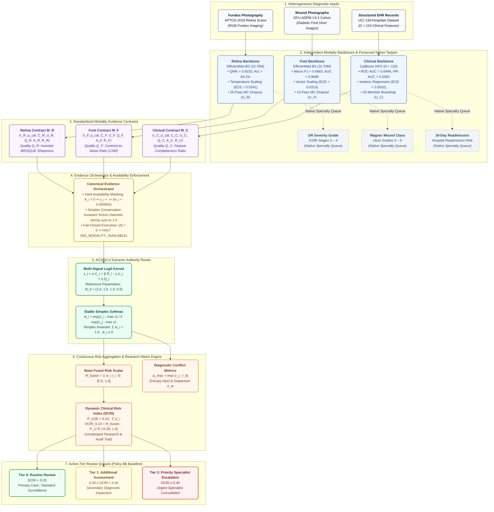

# FusionMedAI

> An interpretable, uncertainty-aware framework for adaptive decision-level routing of heterogeneous medical AI evidence.

[](https://www.python.org/downloads/release/python-3120/)
[](https://pytorch.org/)
[](LICENSE)

---

## 1. FusionMedAI: Overview and Research Contributions

### Abstract
FusionMedAI investigates interpretable decision-level routing across independently trained retinal, diabetic foot-ulcer, and structured clinical prediction models. Its **ACARA-U** (*Adaptive Confidence-, Reliability-, and Uncertainty-Aware routing*) mechanism combines modality-specific confidence, validation-derived reliability, predictive uncertainty, input quality, and explicit availability constraints to allocate relative authority across available evidence sources. A separate Dynamic Clinical Risk Index (DCRI) applies an additive uncertainty penalty to a fused scalar used for controlled review-prioritization experiments.

The framework is evaluated through baseline-policy comparisons, modality-availability regimes, synthetic input degradation, component ablations, conflict stratification, parameter sensitivity, and decision-tier analysis. The experiments characterize how routing and uncertainty discounting change the resulting scores and policy assignments, including under severe synthetic degradation. They also identify limitations, including negative DCRI values, uncertainty-related downward reclassification, and sensitivity near decision thresholds.

The underlying datasets do not provide paired retinal, foot-ulcer, and clinical records for the same individuals. Consequently, the multimodal evaluation uses controlled decision packets rather than a genuinely paired patient cohort. The fused scalar is not a validated probability of a common clinical outcome, and clinical utility, patient-level generalization, and prospective safety remain unestablished. The contribution is an explicit routing formulation and a transparent controlled evaluation of its behavior, trade-offs, and failure modes.

### Core Research Contributions
1. **Interpretable Decision-Level Routing**: An explicit logit-and-softmax formulation combining sample-level confidence ($C_i$), validation-derived reliability priors ($R_i$), predictive uncertainty ($U_i$), input quality ($Q_i$), and hard availability constraints ($A_i$) to allocate weights over the active simplex.
2. **Separately Evaluated Uncertainty-Discounted Index**: A downstream continuous research metric ($\text{DCRI}_\delta = R_{\mathrm{fusion}} - \delta \sum U_i$), with a criteria-based coefficient-selection procedure ($\delta^* = 0.10$), analytical residual bounds, and explicit analysis of negative values and decision-tier consequences.
3. **Controlled Robustness and Ablation Evaluation**: Rigorous empirical characterization across six baseline policies (B1–B6), eight modality-availability regimes, twelve synthetic degradation operators (D0–D3), cross-modality conflict stratification, and one-factor-at-a-time component ablations.
4. **Failure Analysis and Negative Findings**: Transparent documentation of under-triage trade-offs, near-threshold decision sensitivity, clinical confidence semantic sensitivities, and explicit acknowledgment that practical superiority under uncorrupted inputs and multi-cohort tail tests is not established.

---

## 2. System Architecture and Fusion Methodology

### System Architecture Flow



### End-to-End Pipeline Architecture Layers
The FusionMedAI orchestration pipeline operates across six distinct functional layers:
1. **Layer 1: Modality Backbones & Calibrated Risk Projections**:
   - Independently trained diagnostic backbones process distinct clinical modalities (APTOS fundus images, ADPM wound photos, UCI EHR records).
   - In-sample probability calibration (Temperature Scaling for Retina, Vector Scaling for Foot, Isotonic Regression for Clinical) evaluates reliability within each model's native classification task. Calibration of the downstream fused scalar is not established by these individual calibration results.
   - Epistemic predictive uncertainty $U_i \in [0, 1]$ is quantified via Monte Carlo Dropout (imaging) or Bootstrap ensembles (tabular).
2. **Layer 2: Standardized Evidence Contracts & Live Quality Engines**:
   - Each channel encapsulates its state into an immutable 8-tuple contract:
     $$\mathcal{M}_i = \langle r_i, p_{i,\text{cal}}, C_i, U_i, Q_i, A_i, R_i, \text{ver}_i \rangle$$
   - Unsupervised quality engines ($Q_i$) assess signal integrity in real time (e.g., BRISQUE for fundus sharpness, CNR for wound illumination, feature missingness for EHR).
   - Validation-derived reliability priors ($R_i = \frac{1}{2}[\text{AUC}_i + (1 - \text{ECE}_i)]$) anchor channels based on verified predictive track records.
3. **Layer 3: Evidence Orchestrator & Availability Enforcement**:
   - Manages packet ingestion, schemas, and missing-modality safety across the evaluation cohort.
   - Enforces hard availability masking: channels with $A_i = 0$ are assigned logits $z_i = -\infty$, guaranteeing exactly $w_i = 0.000000$ with zero numerical leakage.
   - Implements fail-closed halting when no modalities are available ($|\mathcal{A}| = 0 \implies \text{HALT}$, emitting `NO_MODALITY_AVAILABLE`). Any zero-valued fields in the machine-readable result are serialization placeholders, not valid predictions; no decision tier is assigned.
4. **Layer 4: ACARA-U Dynamic Authority Router**:
   - Computes dynamic routing logits combining all four evidence signals:
     $$z_i = \alpha C_i + \beta R_i - \gamma U_i + \eta Q_i \quad (\Theta_0 = (1.0, 1.5, 1.0, 0.5))$$
   - Allocates authority weights $w_i$ over the active simplex via numerically stable softmax ($\sum_{i \in \mathcal{A}} w_i = 1.0$).
5. **Layer 5: Continuous Risk Aggregation & DCRI Uncertainty Discounting**:
   - Calculates base fused review risk as the authority-weighted sum: $R_{\mathrm{fusion}} = \sum_{i \in \mathcal{A}} w_i r_i$.
   - Computes continuous inter-sensor discordance metrics ($\Delta_{\max}, \sigma_w, \text{CSS}$) to detect diagnostic conflict.
   - Derives the Dynamic Clinical Risk Index ($\text{DCRI}_{0.10} = R_{\mathrm{fusion}} - 0.10 \sum_{i \in \mathcal{A}} U_i$), orthogonally discounting the summary score by cumulative evidential uncertainty without altering upstream routing weights ($\Delta w \equiv 0$).
6. **Layer 6: Action Triage & Optional Safeguard Wrapper**:
   - **Core Evaluated Pipeline (Policy B6 — Standard Unconstrained Triage)**: Maps continuous DCRI scores directly to action tiers ($\tau_1 = 0.20, \tau_2 = 0.40$): Routine Review (Tier 0), Additional Assessment (Tier 1), Priority Escalation (Tier 2). This unconstrained rule is the baseline evaluated across Phases C11.17 and C11.18.
   - **Separately Evaluated Decision Safeguard (Policy S — Candidate Mitigation)**: An optional downstream gateway evaluated separately in Volume 14. If evidence is ambiguous ($\sum U_i \ge 0.30 \lor \min(Q_i) < 0.60$), it blocks downward tier reclassifications relative to base fused risk ($T_{\mathrm{final}} = T(R_{\mathrm{fusion}})$) and emits `FLAG_REPEAT_EXAM_AMBIGUOUS_EVIDENCE` for diagnostic re-testing. Policy S was **not** active in the frozen reference configuration $\Theta_0$ of Policy B6 evaluated in C11.17/C11.18.

---

### Comparative Evaluation of Evidence-Processing Strategies
To evaluate the contribution of adapter-level evidence normalization and orchestration while isolating confidence-definition semantics, FusionMedAI establishes three evaluation tiers operating upstream of the same ACARA-U routing engine ($\Theta_0 = (1.0, 1.5, 1.0, 0.5)$):
1. **Method A — Direct-Packet Routing Baseline (Controlled Baseline)**:
   - Evaluates decision routing and DCRI using standardized packets constructed directly without intermediate adapter transformation or orchestration gating, holding confidence definition, model probabilities, and inputs constant to isolate pipeline overhead.
   - When inputs and confidence semantics are held identical, routing calculations on valid packets produce exact machine-precision numerical agreement ($\max \lvert\Delta w\rvert < 5.0 \times 10^{-7}$). The primary contribution of the canonical pipeline is therefore architectural safety, strict type invariants, and fail-closed availability gating rather than numerical deviation on clean inputs.
2. **Method B — Canonical Evidence-Pipeline Routing (Primary)**:
   - Evaluates the complete multi-stage pipeline: $\text{Modality Adapters} \longrightarrow \text{EvidenceOrchestrator} \longrightarrow \text{ACARA-U Router} \longrightarrow \text{DCRI Evaluation}$.
   - Strictly enforces semantic evidence contracts, fail-closed safety assertions, and consistent decision-boundary confidence margins ($C_{\text{clinical}} = 2\lvert\hat{p} - 0.5\rvert$, mean $0.776$).
3. **Method C — Confidence-Definition Sensitivity Comparison (Heuristic Comparator)**:
   - Deliberately tests the alternative heuristic confidence definition ($C_{\text{alt}} = 1 - 2\lvert\hat{p} - 0.5\rvert$, mean $0.224$, where $C_{\text{alt}} + C_{\text{canonical}} = 1.0$).
   - Because confidence enters the logit kernel directly ($z_i = \alpha C_i + \beta R_i - \gamma U_i + \eta Q_i$), this semantic shift accounts for the observed authority shift between historical unnormalized packets and the canonical pipeline.

#### Strategy and Sensitivity Comparison Summary ($N=500$, seed 115, $\Theta_0$)

| Evaluation Dimension | Method A: Direct Baseline (Canonical C) | Method B: Canonical Pipeline (Primary) | Method C: Heuristic Confidence (C_alt) | Methodological Impact & Attribution |
| :--- | :---: | :---: | :---: | :--- |
| **Retina Weight (w_R)** | **42.71% ± 7.88%** | **42.71% ± 7.88%** | 50.10% ± 8.83% | Method A & B identical; Method C shifts +7.39% due to low clinical C |
| **Foot Ulcer Weight (w_F)** | **22.31% ± 7.72%** | **22.31% ± 7.72%** | 26.09% ± 8.64% | Method A & B identical; Method C shifts +3.78% |
| **Clinical EHR Weight (w_C)** | **34.98% ± 6.50%** | **34.98% ± 6.50%** | 23.81% ± 5.23% | Canonical boundary confidence increases tabular authority (+11.17%) |
| **Routing Shannon Entropy** | **1.038987 nats** | **1.038987 nats** | 1.011041 nats | Canonical confidence yields higher allocation balance (+0.027946 nats) |
| **Retina Dominance Rate** | **73.2% (366 / 500)** | **73.2% (366 / 500)** | 91.2% (456 / 500) | Canonical confidence avoids excessive single-channel concentration |
| **Mean Fused Risk (R_fusion)** | **0.261017** | **0.261017** | 0.289900 | Difference between B and C driven entirely by clinical confidence definition |
| **Mean DCRI (DCRI_0.10)** | **0.197624** | **0.197624** | 0.226506 | Proportional shift preserving unweighted penalty (P_U = 0.063394) |
| **Negative DCRI Count** | **38 (7.6%)** | **38 (7.6%)** | 37 (7.4%) | Stable bounded negative frequency (<= 10% criterion met across all) |
| **Action Tier Distributions** | **52.4% / 36.2% / 11.4%** | **52.4% / 36.2% / 11.4%** | 46.4% / 37.4% / 16.2% | Method A and B match; Method C assigns more cases to Escalation |
| **Contract & Invariant Gating** | Permissive / Unvalidated | **Enforced / Fail-Closed** | Permissive / Unvalidated | Primary contribution of Method B is architectural safety and invariant checks |

*Methodological Finding*: When confidence semantics and inputs are held constant (Method A vs Method B), routing outputs match to within floating-point tolerance ($\Delta w < 5.0 \times 10^{-7}$). The numeric authority reallocation is entirely explained by the confidence semantic definition (Method C vs Method B), while Method B provides automated invariant gating, semantic typing, and fail-closed availability enforcement.

### Target Preservation & Rejection of Common-Target Collapse
### Target Preservation & Rejection of Common-Target Collapse
FusionMedAI explicitly rejects the practice of forcing clinically heterogeneous prediction targets into a single scalar "universal clinical risk":
- **Retinal Endpoint ($r_R \in [0, 1]$)**: Scalar projection derived from 5-class diabetic retinopathy severity grading (ICDR Stages 0–4: No DR, Mild, Moderate, Severe, Proliferative), calibrated via Temperature Scaling. The task grades visible disease severity at examination, not longitudinal retinopathy progression.
- **Foot Ulcer Endpoint ($r_F \in [0, 1]$)**: Continuous projection derived from the multi-class DFU wound classifier (evaluating tissue ulceration and Wagner wound grading), calibrated via Vector Scaling.
- **Clinical EHR Endpoint ($r_C \in [0, 1]$)**: Calibrated posterior probability of acute 30-day hospital readmission from CatBoost (calibrated via Isotonic Regression, test ECE = 0.0032).
- **Core Comparability Boundary**: Each model retains its native prediction target. Scalar projections are used as inputs to the controlled decision-level fusion experiments; the resulting fused index ($R_{\mathrm{fusion}}$) is a review-prioritization measure and is not a validated probability of a common clinical outcome.
- **Preserved Native Outputs**: In any potential clinical workflow, each modality's discrete prediction and native target must be preserved and presented in its native specialty context.

---

## 3. Modality-Specific Models and Independent Evaluation

Each modality backbone was evaluated on held-out test partitions under strict leakage-prevention controls and frozen contracts:

| Modality & Dataset | Architecture & Params | Primary Performance | Probability Calibration | Uncertainty Quantification | Explainability | Research Volume |
| :--- | :--- | :---: | :---: | :---: | :---: | :--- |
| **Retina (Fundus)**<br>APTOS 2019 ($N_{\text{test}} = 367$ held-out 10% test split) | EfficientNet-B3<br>(10.70M params) | **QWK = 0.9233**<br>Acc = 84.20% | Temperature Scaling<br>ECE = 0.0241 | 25-pass MC Dropout<br>Error AUROC = 0.8443 | Spatial Grad-CAM<br>(Microaneurysms) | [Retina Volume 05](research/retina/Volume_05_Architecture_Benchmarking/README.md) |
| **Foot Ulcer (Wound)**<br>ADPM V3.3 ($N_{\text{test}} = 1,006$ held-out 20% test split) | EfficientNet-B3<br>(10.70M params) | **Macro F1 = 0.6683**<br>Macro AUC = 0.8685 | Vector Scaling<br>ECE = 0.0313 | 10-pass MC Dropout<br>Entropy AUROC = 0.7291 | Spatial Grad-CAM<br>(Wound margins) | [Foot Volume 05](research/foot/Volume_05_Architecture_Benchmarking/README.md) |
| **Clinical Tabular (EHR)**<br>UCI 130-Hosp ($N_{\text{test}} = 14,913$ held-out 20% test split) | CatBoost HPO<br>(D = 119 features) | **ROC-AUC = 0.6494**<br>PR-AUC = 0.2063 | Isotonic Regression<br>ECE = 0.0032 | 20-member Bootstrap<br>Error AUROC = 0.7116 | Exact TreeSHAP<br>(rho = 0.9994) | [Clinical Volume 05](research/clinical/Volume_05_Architecture_Benchmarking/README.md) |

### Modality Contract Fields & Reliability Priors
Each modality emits an 8-tuple contract:

$$
\mathcal{M}_i = \langle r_i, p_{i,\text{cal}}, C_i, U_i, Q_i, A_i, R_i, \text{ver}_i \rangle
$$

The static reliability prior scales each channel's baseline authority using frozen held-out validation evidence:

$$
R_i = \frac{1}{2} \left[ \text{AUC}_i + (1 - \text{ECE}_i) \right]
$$

- **Retina ($R_R = 0.929956$)**: Validation Macro OvR $\text{AUC} = 0.911149$, Validation 10-bin equal-frequency $\text{ECE} = 0.051237$ ($N_{\text{val}} = 366$).
- **Foot Ulcer ($R_F = 0.922266$)**: Validation Macro OvR $\text{AUC} = 0.884435$, Validation 10-bin equal-frequency $\text{ECE} = 0.039903$ ($N_{\text{val}} = 1,006$).
- **Clinical EHR ($R_C = 0.825382$)**: Validation Binary $\text{AUC} = 0.650764$, in-sample validation isotonic $\text{ECE} = 0.000000$ ($N_{\text{val}} = 14,911$).

### Clinical Reliability Prior Provenance & Router Sensitivity
The static reliability prior $R_i$ is a heuristic prior computed from pre-declared validation metrics:

| Metric / Parameter | Value | Split / Calibration Method | Role in System |
| :--- | :---: | :--- | :--- |
| **Frozen Reference Prior ($R_C$)** | **0.825382** | In-sample Validation ($N_{\text{val}}=14,911$), Isotonic $\text{ECE}=0.0$, $\text{AUC}=0.6508$ | Reference configuration $\Theta_0$ in router |
| **Test-Set Calibration Reference** | 0.823782 | Held-out Test ($N_{\text{test}}=14,913$), Isotonic $\text{ECE}=0.0032$, $\text{AUC}=0.6494$ | Confirms router logit shift $\le 0.0030$ is negligible |
| **Alternative Platt Scaling Prior** | 0.823882 | Validation ($N_{\text{val}}=14,911$), Platt $\text{ECE}=0.0030$ | Sensitivity comparator ($\Delta R_C \le 0.0015$) |

The variation between in-sample protocol value ($0.825382$) and test-set estimates ($0.823782$) is bounded by $\Delta R_C \le 0.0020$ ($< 0.25\%$), producing a negligible shift in downstream routing logits ($\beta \cdot \Delta R_C \le 0.0030$). The pre-registered protocol value $R_C = 0.825382$ is retained for consistency.

### Standardized Feature Scales: Quality and Confidence ($Q_i, C_i \in [0, 1]$)
Before routing, input features are normalized onto explicit $[0, 1]$ intervals:
- **Input Quality ($Q_i \in [0, 1]$)**: Evaluated independently per modality where $1.0$ indicates pristine signal fidelity and $0.0$ indicates severe noise:
  - **Retina ($Q_R$)**: Unsupervised BRISQUE sharpness score, inverted and min-max normalized ($Q_R \in [0, 1]$; higher = sharper fundus photography).
  - **Foot Ulcer ($Q_F$)**: Contrast-to-Noise Ratio (CNR) between wound bed and periwound skin, normalized into $[0, 1]$ (higher = superior illumination and contrast).
  - **Clinical EHR ($Q_C$)**: Completeness ratio ($1 - \text{fraction of missing features}$) across the 119 tabular features ($Q_C \in [0, 1]$; higher = complete record).
  - *Missing/corrupted measurements*: Fall back safely to $Q_i = 0.0$.
- **Predictive Confidence ($C_i \in [0, 1]$)**:
  - **Retina & Foot ($C_R, C_F$)**: Winning-class calibrated posterior probability $C_i = \max_c \hat{p}_{i,c} \in [0.20, 1.0]$.
  - **Clinical EHR ($C_C$)**: Decision-boundary margin metric $C_C = 2|\hat{p} - 0.5| = |p_1 - p_0| \in [0, 1]$. Because baseline readmission prevalence is low ($\sim 11\%$), confident non-readmission predictions ($\hat{p} \approx 0.10$) produce high margin confidence ($C_C \approx 0.80$). This reflects distance from the decision boundary, not posterior probability of a positive outcome.

---

## 4. ACARA-U: Evidence Routing and Authority Weights

### Routing Kernel Formulation
For each available modality $i \in \mathcal{A}$, the unnormalized routing logit $z_i$ is computed as:

$$
z_i = \alpha C_i + \beta R_i - \gamma U_i + \eta Q_i
$$

with frozen reference coefficients $\Theta_0 = (\alpha=1.0, \beta=1.5, \gamma=1.0, \eta=0.5)$.

To strictly prevent authority leakage to missing sensors, hard availability masking is applied:

$$
\tilde{z}_i = \begin{cases} z_i & \text{if } A_i = 1 \\ -\infty & \text{if } A_i = 0 \end{cases}
$$

Routing authority weights $w_i \in [0, 1]$ are assigned using stable softmax over active channels:

$$
w_i = \frac{\exp(\tilde{z}_i - \max_{j \in \mathcal{A}} \tilde{z}_j)}{\sum_{k \in \mathcal{A}} \exp(\tilde{z}_k - \max_{j \in \mathcal{A}} \tilde{z}_j)}
$$

### Canonical Routing Invariants & Distributions ($N=500$, seed 115)
Evaluated on the canonical manifest (`cf877d74e306...`):

| Routing Metric | Canonical Measured Value | Traceability / Artifact Link |
| :--- | :---: | :--- |
| **Mean Authority Weights (w_R / w_F / w_C)** | **42.71% ± 7.88% / 22.31% ± 7.72% / 34.98% ± 6.50%** | [`03_router_intermediate_comparison.json`](experiments/fusion/canonical_redesigned_rerun/03_router_intermediate_comparison.json#L20-L25) |
| **Routing Entropy (H_bar)** | **1.038987 ± 0.040595 nats** (Range: [0.8979, 1.0984]) | [`03_router_intermediate_comparison.json`](experiments/fusion/canonical_redesigned_rerun/03_router_intermediate_comparison.json#L26) |
| **Dominant Modality Counts** | **Retina: 366 (73.2%), Clinical: 110 (22.0%), Foot: 24 (4.8%)** | [`03_router_intermediate_comparison.json`](experiments/fusion/canonical_redesigned_rerun/03_router_intermediate_comparison.json#L28-L32) |
| **Simplex Preservation** | **Sum(w_i) = 1.000000 ± 1.11e-16** | [`test_evidence_orchestration.py`](verification/fusion/contract/test_evidence_orchestration.py) |
| **Missing-Modality Invariant** | **w_i == 0.000000 for all A_i = 0** (0 violations / 7,500 trials) | [`Volume 08 Missing Modality`](research/fusion/Volume_08_Missing_Modality_Robustness/README.md) |
| **Fail-Closed Degeneracy** | **|A| = 0 => HALT** (`NO_MODALITY_AVAILABLE`, R = 0.0) | [`Volume 17 Decision Evaluation`](research/fusion/Volume_17_Decision_Level_Evaluation/README.md) |

### Comparative Baseline Ladder (B1–B6)
Evaluated across six pre-registered allocation policies on the canonical $N=500$ cohort:

| Baseline ID | Strategy Name | Routing Logit Formulation | Mean Fused Risk | Mean DCRI | Routing Entropy | Negative DCRI Count |
| :--- | :--- | :--- | :---: | :---: | :---: | :---: |
| **B1** | Reliability-Selected | w_retina == 1.0 (Unimodal) | 0.255037 | 0.191643 | 0.0000 | 223 (44.6%) |
| **B2** | Uniform Average | w_i = 1 / |A| | 0.296804 | 0.233410 | 1.0986 | 0 (0.0%) |
| **B3** | Confidence Fusion | z_i = 1.0 C_i | 0.282063 | 0.218670 | 1.0841 | 0 (0.0%) |
| **B4** | Conf. + Reliability | z_i = 1.0 C_i + 1.5 R_i | 0.287679 | 0.224286 | 1.0843 | 0 (0.0%) |
| **B5** | Conf + Rel - Uncertainty | z_i = 1.0 C_i + 1.5 R_i - 1.0 U_i | 0.257236 | 0.193843 | 1.0403 | 36 (7.2%) |
| **B6** | **Full ACARA-U** | z_i = 1.0 C_i + 1.5 R_i - 1.0 U_i + 0.5 Q_i | **0.261017** | **0.197624** | **1.0390** | **38 (7.6%)** |

*Cohort Formulation & Negative Count Reconciliation*: Results in this table reflect the Canonical Redesigned Rerun cohort ($N=500$, seed 115, boundary-referenced clinical confidence $C_C = 2|\hat{p}-0.5|$), where B6 produces 38 negative scores (and B5 produces 36). The frozen Phase C11.17 baseline (evaluated with raw probability confidence $C_i = \hat{p}_i$) produced 37 negative scores in B6 (and 35 in B5); this single-packet shift on `PACKET_0068` is forensically reconciled in [Volume 18 Chapter 06](research/fusion/Volume_18_Failure_Analysis/06_Discrepancy_Reconciliation.md).
*Artifact Traceability*: [`04_canonical_c11_full_metrics.json`](experiments/fusion/canonical_redesigned_rerun/04_canonical_c11_full_metrics.json#L1826-L2032).

---

## 5. DCRI: Research Index and Parameter Selection

### Mathematical Definition & Domain
The Dynamic Clinical Risk Index (DCRI) calculates an uncertainty-discounted continuous research index by applying an additive unweighted penalty for cumulative epistemic uncertainty to the authority-weighted fused risk:

$$
R_{\text{fusion}} = \sum_{i \in \mathcal{A}} w_i r_i
$$

$$
P_U(\delta) = \delta \sum_{i \in \mathcal{A}} U_i = \delta U_{\text{sum}}
$$

$$
\text{DCRI}_\delta = R_{\text{fusion}} - P_U(\delta) = \sum_{i \in \mathcal{A}} w_i r_i - \delta \sum_{i \in \mathcal{A}} U_i
$$

- **Continuous Theoretical Domain**: Because $R_{\text{fusion}} \in [0, 1]$ and each active uncertainty $U_i \in [0, 1]$, the theoretical domain spans $[-\delta |\mathcal{A}|, 1.0]$. For the frozen setting $\delta^* = 0.10$ across up to three modalities ($|\mathcal{A}| \le 3$), the numerical domain is $[-0.30, 1.0]$.
- **Unclamped Negative Score Mechanics**: Negative DCRI occurs when cumulative uncertainty penalty strictly exceeds base fused risk ($P_U > R_{\text{fusion}}$). Negative scores are **intentionally left unclamped** rather than truncated to $0.0$. In research analysis, negative scores preserve rank ordering, maintain mathematical continuity, and provide an unclipped diagnostic signal that the evidence is too epistemically opaque to substantiate a positive risk assertion.

### Double-Use of Uncertainty in Architecture
Predictive uncertainty ($U_i$) serves two distinct, decoupled roles within the FusionMedAI framework:
1. **Relative Authority Modulation (Upstream Router)**:
   In the ACARA-U routing kernel, $-\gamma U_i$ acts as an unnormalized logit penalty. Modalities with higher predictive uncertainty surrender simplex authority to lower-uncertainty peers, redistributing relative weights ($w_i$).
2. **Absolute Evidential Discounting (Downstream Aggregation)**:
   In DCRI risk aggregation, $-\delta \sum U_i$ applies an unweighted additive penalty to the summary score. This reflects the total unobserved epistemic ignorance of the multi-sensor system, discounting confidence in the fused scalar regardless of which modality dominated the weights.

### Core Mathematical Invariants of DCRI
- **Monotonic Non-Inflation Invariant**: $\forall \delta \ge 0, U_i \ge 0 \implies \text{DCRI}_\delta \le R_{\text{fusion}}$. Epistemic discounting can only reduce or maintain the summary score; it is mathematically impossible for DCRI to inflate risk above base projections.
- **Strict Downstream Orthogonality**: Varying the penalty factor $\delta$ alters downstream $\text{DCRI}$ with exact zero feedback to upstream routing: $\Delta w_i \equiv 0.000000$ and $\Delta R_{\text{fusion}} \equiv 0.000000$ across all candidate values.
- **Exact Analytical Gradient**: The sensitivity derivative $\frac{\partial \overline{\text{DCRI}}}{\partial \delta} = -\overline{U_{\text{sum}}} = -0.633936$ holds with machine-precision zero residual ($< 10^{-16}$) across all candidate intervals.

### Rationale and Multi-Criteria Selection for $\delta^* = 0.10$
The research discount factor $\delta^* = 0.10$ was frozen via a pre-registered 11-candidate sweep ($\delta \in [0.00, 1.00]$) evaluated against three pre-declared criteria:
1. **Bounded Negative Rate**: Keep negative DCRI occurrences under $10\%$ on the tri-modal cohort.
2. **Rank Preservation**: Maintain rank fidelity with base fused risk (Spearman $\rho_s > 0.95$).
3. **Meaningful Penalty Discrimination**: Ensure mean penalty $P_U$ constitutes $15\%\text{--}30\%$ of mean base risk.

### Candidate Grid Evaluation ($N=500$, canonical rerun):

| Candidate ID | Discount Factor $\delta$ | Mean DCRI $\overline{\text{DCRI}}$ | Negative Rate (%) | Spearman Rank $\rho_s$ | Selection Status & Boundary |
| :---: | :---: | :---: | :---: | :---: | :--- |
| `D00` | $0.00$ | $0.261017$ | $0.0\%$ | $1.000000$ | Unpenalized baseline ($P_U \equiv 0$) |
| `D05` | $0.05$ | $0.229320$ | $0.0\%$ | $0.996144$ | Insufficient penalty discrimination |
| **`D10`** | **$0.10$** | **$0.197624$** | **$7.6\%$ ($38/500$)** | **$0.985623$** | **SELECTED RESEARCH OPERATING POINT** |
| `D15` | $0.15$ | $0.165927$ | $15.8\%$ | $0.969854$ | Exceeds 10% negative threshold |
| `D20` | $0.20$ | $0.134230$ | $25.4\%$ ($127/500$) | $0.949821$ | Historical provisional setting (excessive penalty) |
| `D50` | $0.50$ | $-0.055951$ | $67.4\%$ ($337/500$) | $0.825694$ | Severe rank inversion; negative mean score |

*Verification & Confirmation*: Under the canonical rerun, `D10` ($\delta = 0.10$) uniquely satisfies all three pre-registered acceptance criteria (negative rate $7.6\% \le 10\%$, rank preservation $\rho_s = 0.985623 > 0.95$, penalty ratio $P_U / \overline{R} = 24.28\% \in [15\%, 30\%]$). The selection remains fully supported under the canonical evaluation path.

### Regime Scaling Behavior Across Modality Permutations ($N=500$)
Because the penalty is additive across active channels ($P_U = 0.10 \sum_{i \in \mathcal{A}} U_i$), negative DCRI rates scale predictably with modality cardinality $\lvert\mathcal{A}\rvert$:

| Active Regime | Active Channels $\mathcal{A}$ | Cardinality $M$ | Mean Fused Risk $\overline{R}$ | Mean Penalty $\overline{P}_U$ | Mean $\overline{\text{DCRI}}_{0.10}$ | Negative DCRI Count (%) |
| :---: | :---: | :---: | :---: | :---: | :---: | :---: |
| **RFC** | $\{R, F, C\}$ | 3 | $0.261017$ | $0.063394$ | $0.197624$ | $38\ (7.6\%)$ |
| **RF** | $\{R, F\}$ | 2 | $0.346995$ | $0.059529$ | $0.287466$ | $18\ (3.6\%)$ |
| **RC** | $\{R, C\}$ | 2 | $0.177922$ | $0.004002$ | $0.173920$ | $13\ (2.6\%)$ |
| **FC** | $\{F, C\}$ | 2 | $0.279413$ | $0.063256$ | $0.216157$ | $7\ (1.4\%)$ |
| **R** | $\{R\}$ | 1 | $0.255037$ | $0.000138$ | $0.254899$ | $15\ (3.0\%)$ |
| **F** | $\{F\}$ | 1 | $0.521907$ | $0.059392$ | $0.462515$ | $6\ (1.2\%)$ |
| **C** | $\{C\}$ | 1 | $0.113468$ | $0.003864$ | $0.109604$ | $4\ (0.8\%)$ |
| **EMPTY** | $\emptyset$ | 0 | $0.000000^*$ | $0.000000^*$ | $0.000000^*$ | $0\ (0.0\%)$ |

*Mathematical Identity & Foot Regime Reconciled*: Across all active regimes, the mathematical identity $\overline{R}_{\mathrm{fusion}} - \overline{\mathrm{DCRI}}_{0.10} = 0.10 \overline{U}_{\mathrm{sum}}$ holds exactly. For the unimodal foot regime ($F$), mean uncertainty is $\overline{U}_F = 0.593918$, yielding mean penalty $\overline{P}_U = 0.10 \times 0.593918 = 0.059392 \le 0.10$ and $\overline{\text{DCRI}}_{0.10} = 0.462515$. (Historical drafts reported $0.403124$ with penalty $0.118783$, which reflected the provisional $\delta=0.20$ sweep from Volume 08).
*Empty Modality Rejection*: When no modality is available, the orchestrator fails closed and emits `NO_MODALITY_AVAILABLE`. Any zero-valued fields ($^*$) in machine-readable records are serialization placeholders, not valid predictions; no decision tier is assigned.
*Candidate Grid Subset*: The 6 rows in the candidate grid above represent a summary subset of the 11 pre-registered candidate sweeps ($\delta \in [0.00, 1.00]$); the full grid is archived in [Volume 13](research/fusion/Volume_13_DCRI_Delta_Selection/README.md). The negative-rate boundary ($\le 10\%$) and rank-preservation criteria ($\rho_s > 0.95$) are research operating-point selection rules for controlled decision experiments, not clinical safety thresholds.
*Decoupling from Decision Policy*: While DCRI produces a mathematically bounded continuous research score, Section 6 shows that unconstrained linear uncertainty discounting can lower triage priority for low-baseline cases with high uncertainty. This motivates evaluating downstream safeguard policies (such as Policy S) separately from the core continuous routing engine.
*Artifact Traceability*: [`04_canonical_c11_full_metrics.json`](experiments/fusion/canonical_redesigned_rerun/04_canonical_c11_full_metrics.json#L344-L474); [Volume 06 DCRI Aggregation](research/fusion/Volume_06_DCRI_Aggregation/README.md); [Volume 13 DCRI Delta Selection](research/fusion/Volume_13_DCRI_Delta_Selection/README.md).

---

## 6. Decision-Policy Analysis: Base Risk vs DCRI vs Safeguarded Policy S
To evaluate how uncertainty discounting and safety gating influence clinical resource allocation, we evaluate a hypothetical 3-tier action policy on the canonical cohort ($N=500$, seed 115) with standard operating thresholds $\tau_1 = 0.20, \tau_2 = 0.40$:
- **Tier 0 (Routine Review)**: $\text{Score} < 0.20$ (Primary care / standard surveillance queue)
- **Tier 1 (Additional Assessment)**: $0.20 \le \text{Score} < 0.40$ (Secondary diagnostic inspection / intermediate queue)
- **Tier 2 (Priority Escalation)**: $\text{Score} \ge 0.40$ (Urgent specialist consultation queue)

### Three-Policy Master Comparison ($N=500$, Canonical Cohort)

| Policy Name | Score Evaluated | T0 (Routine) | T1 (Assessment) | T2 (Escalation) | Downgrades vs Base | Blocked Downgrades | Repeat-Exam Flags | Policy Status & Scope |
| :--- | :--- | :---: | :---: | :---: | :---: | :---: | :---: | :--- |
| **1. Base-Risk Policy** | $R_{\mathrm{fusion}} \in [0, 1]$ | 192 (38.4%) | 225 (45.0%) | 83 (16.6%) | — | — | — | Unpenalized evidence reference |
| **2. Unconstrained DCRI (B6)** | $\text{DCRI}_{0.10} = R_{\mathrm{fusion}} - 0.10 U_{\mathrm{sum}}$ | **262 (52.4%)** | **181 (36.2%)** | **57 (11.4%)** | **96 (19.2%)** | — | — | Evaluated baseline; -31.3% escalations; false-downgrade trade-off |
| **3. Safeguarded DCRI (Policy S)** | Safeguard Gateway on $\text{DCRI}_{0.10}$ | **193 (38.6%)** | **225 (45.0%)** | **82 (16.4%)** | **2 (0.4%)** | **94 / 96 (97.9%)** | **432 / 500 (86.4%)** | Separately evaluated downstream mitigation ([Volume 14](research/fusion/Volume_14_DCRI_Decision_Policy_Analysis/README.md)); high repeat workload |

### Downward Reclassification & Safeguard Mechanics
1. **Unconstrained Monotonic Non-Inflationary Property (Policy 2 vs Policy 1)**:
   Because $\text{DCRI}_{0.10} \le R_{\mathrm{fusion}}$ for all valid packets, unconstrained uncertainty discounting never escalates a case:
   - **Total Reclassifications**: 96 / 500 decision packets (19.2%, 95% Wilson CI: [16.0%, 22.9%]).
   - **Directionality**: Exactly 96 / 96 (100%) are downward shifts (70 from Tier 1 to Tier 0, 26 from Tier 2 to Tier 1); 0 upgrades (0.0%).
   - **Escalation Reduction**: High-urgency specialist referrals drop from 83 to 57 in this cohort (a **31.3% relative reduction**).
2. **Separately Evaluated Safeguard Gateway (Policy S)**:
   Evaluated separately in Volume 14, Policy S intercepts transitions downstream when evidence is ambiguous:

   $$
   \text{Ambiguous}(\mathbf{x}) \iff \left(\sum_{i \in \mathcal{A}} U_i \ge 0.30\right) \lor \left(\min_{i \in \mathcal{A}} Q_i < 0.60\right)
   $$

   - **Observed Downgrade Suppression**: When ambiguous and $T_{\mathrm{DCRI}} < T_{\mathrm{base}}$, the case is held at its base risk tier ($T_{\mathrm{final}} = T_{\mathrm{base}}$), blocking **94 of 96 attempted downgrades (97.9%)** in the reported canonical policy experiment, leaving 2 unblocked under low uncertainty ($U_{\mathrm{sum}} < 0.30, Q \ge 0.60$).
   - **Specialist Referrals Retained**: In this experiment, 82 of 83 specialist escalations were observed to be retained ($98.8\%$), rather than downgraded into routine queues.
   - **Operational Repeat-Exam Trade-Off**: The policy emits `FLAG_REPEAT_EXAM_AMBIGUOUS_EVIDENCE` for downstream clinical review across **$432 / 500$ packets ($86.4\%$)**. Whether the flag results in an actual repeat examination, and whether that workflow improves clinical outcomes, has not been evaluated. This high flag rate creates a major operational workload trade-off rather than proving the safeguard is ready for clinical deployment.

> [!WARNING]
> **Controlled Simulation Outcome — Not a Clinically Validated Decision**:
> In synthetic oracle evaluations ($N=5,000$), unconstrained DCRI discounting reduces false specialist alarms but increases false downgrades of high-risk cases from $7.61\%$ to $12.72\%$. While Policy S was designed to mitigate this by blocking 94 of 96 downgrades in the simulation, it introduces an 86.4% repeat-diagnostic flag burden. Policy S was **not** active in the frozen baseline B6 evaluated in C11.17/C11.18.

*Artifact Traceability*:
- **Canonical Redesigned Cohort**: [`canonical_safeguarded_policy_results.json`](experiments/fusion/canonical_redesigned_rerun/canonical_safeguarded_policy_results.json); full metrics in [`04_canonical_c11_full_metrics.json`](experiments/fusion/canonical_redesigned_rerun/04_canonical_c11_full_metrics.json#L1601-L1658).
- **Baseline Decision Cohort**: [`safeguarded_policy_results.json`](experiments/fusion/dcri_policy_analysis/results/safeguarded_policy_results.json); verified by [`verify_policy_artifacts.py`](verification/fusion/dcri_policy_analysis/verify_policy_artifacts.py).

---

## 7. Sensitivity Analysis and Ablation Studies

### A. One-Factor-At-A-Time (OFAT) Component Ablations ($N=500$)
Evaluates the isolated impact of deleting each component in ACARA-U on the canonical cohort:

| Ablation ID | Removed Component | Mean w_R | Mean w_F | Mean w_C | Mean R_fusion | Mean DCRI | Reclassified vs A0 | Key Structural Finding |
| :---: | :--- | :---: | :---: | :---: | :---: | :---: | :---: | :--- |
| **A0** | **Full B6 Reference** | **42.71%** | **22.31%** | **34.98%** | **0.261017** | **0.197624** | **0** | Baseline reference configuration |
| **A1** | No Confidence (alpha=0) | 43.01% | 23.30% | 33.69% | 0.274761 | 0.211368 | 34 (6.8%) | Clinical authority drops -1.3%; risk shifts +0.0137 |
| **A2** | No Reliability (beta=0) | 40.26% | 21.28% | 38.46% | 0.253192 | 0.189799 | 21 (4.2%) | Removes prior anchor; clinical authority increases +3.5% |
| **A3** | No Uncertainty (gamma=0) | 36.42% | 32.84% | 30.74% | 0.291355 | 0.227962 | 63 (12.6%) | Foot surges +10.5%; highest risk distortion (Delta R = +0.0303) |
| **A4** | No Quality (eta=0) | 41.75% | 22.34% | 35.91% | 0.259849 | 0.196456 | 2 (0.4%) | Minor authority shift on clean inputs (Delta w < 1.0%) |
| **A5** | No DCRI Discount (delta=0) | 42.71% | 22.31% | 34.98% | 0.261017 | 0.261017 | 96 (19.2%) | **Exact downstream orthogonality**: Delta w == 0, Delta R == 0 |

### B. Corrected Component Attribution Hierarchy
In the canonical execution path where clinical confidence reflects true decision-boundary distance ($C_C = 2\lvert p_1 - 0.5\rvert$, mean $0.776$):
1. **Uncertainty Penalty ($\gamma$)**: Primary active modulator. Removing $\gamma$ produces the largest risk deviation ($\Delta R = +0.030338$) and highest tier reclassifications ($63/500$).
2. **Confidence Weighting ($\alpha$)**: Second most influential factor. Removing $\alpha$ produces $\Delta R = +0.013744$ and $34/500$ reclassifications.
3. **Reliability Prior ($\beta$)**: Anchors authority to validated modalities ($\Delta R = -0.007825$, $21/500$ reclassifications).
4. **Quality Bonus ($\eta$)**: Gentle background term on clean data ($\Delta R = -0.001168$, $2/500$ reclassifications), activating decisively under sensor corruption.
5. **Downstream Discount Orthogonality ($\delta$)**: Setting $\delta = 0$ shifts DCRI by exactly $+0.063394$ without altering routing weights ($\Delta w \equiv 0.000000$).
*Artifact Traceability*: [`04_canonical_c11_full_metrics.json`](experiments/fusion/canonical_redesigned_rerun/04_canonical_c11_full_metrics.json#L1664-L1825); [Volume 16 Component Ablation Study](research/fusion/Volume_16_Component_Ablation_Study/README.md).

---

## 8. Input Degradation and Missing-Modality Safety

### Missing-Modality Safety Invariants across 8 Regimes ($N=500$)
Evaluates ACARA-U across all combinations of modality availability:

| Regime | Active Channels $\mathcal{A}$ | Mean Fused Risk $\overline{R}$ | Mean DCRI $\overline{\text{DCRI}}_{0.10}$ | Negative DCRI Count (%) | Software Availability Invariant |
| :---: | :---: | :---: | :---: | :---: | :--- |
| **RFC** | $\{R, F, C\}$ | $0.261017$ | $0.197624$ | $38\ (7.6\%)$ | Verified zero leakage ($w \equiv 0$ for $\notin \mathcal{A}$) |
| **RF** | $\{R, F\}$ | $0.346995$ | $0.287466$ | $18\ (3.6\%)$ | Inactive clinical zeroed ($w_C \equiv 0.000000$) |
| **RC** | $\{R, C\}$ | $0.177922$ | $0.173920$ | $13\ (2.6\%)$ | Inactive foot zeroed ($w_F \equiv 0.000000$) |
| **FC** | $\{F, C\}$ | $0.279413$ | $0.216157$ | $7\ (1.4\%)$ | Inactive retina zeroed ($w_R \equiv 0.000000$) |
| **R** | $\{R\}$ | $0.255037$ | $0.254899$ | $15\ (3.0\%)$ | Singleton unity ($w_R \equiv 1.000000$) |
| **F** | $\{F\}$ | $0.521907$ | $0.462515$ | $6\ (1.2\%)$ | Singleton unity ($w_F \equiv 1.000000$) |
| **C** | $\{C\}$ | $0.113468$ | $0.109604$ | $4\ (0.8\%)$ | Singleton unity ($w_C \equiv 1.000000$) |
| **EMPTY** | $\emptyset$ | $0.000000^*$ | $0.000000^*$ | $0\ (0.0\%)$ | Fail-closed `NO_MODALITY_AVAILABLE` (no tier assigned) |

*Software Behavior vs Clinical Invariants*: Missing-modality tests establish that the software router strictly zeroes weights for absent modalities without numerical leakage ($0$ violations across $4,000$ evaluations). When no modality is available, execution halts with status `NO_MODALITY_AVAILABLE`. Zero values ($^*$) are serialization placeholders, not valid predictions; no decision tier is assigned.
*Signal Degradation Scope*: Real-time quality terms ($Q_i$) down-weight degraded modalities under synthetic noise injections ($D_1\text{--}D_3$, $36.7\%\text{--}51.7\%$ relative authority reduction). However, synthetic degradation responses do not establish robustness to complex, unmodeled clinical acquisition failures in prospective hospital deployments.

*Artifact Traceability*: [`04_canonical_c11_full_metrics.json`](experiments/fusion/canonical_redesigned_rerun/04_canonical_c11_full_metrics.json#L344-L474); [Volume 08 Missing Modality](research/fusion/Volume_08_Missing_Modality_Robustness/README.md); [Volume 10 Input Degradation](research/fusion/Volume_10_Input_Degradation/README.md).

---

## 9. Synthetic Benchmark and Statistical Results

### A. Confirmatory Synthetic Oracle Benchmark ($N=5,000$, 10 Seeds)
A pre-registered synthetic oracle benchmark evaluated estimation error (MAE) against simulated ground-truth targets:

| Scenario / Condition | Sample Size ($N$) | Metric Evaluated | B6 vs B5 Difference | Empirical Scope & Interpretation |
| :--- | :---: | :---: | :---: | :--- |
| **Overall Synthetic Benchmark** | $5,000$ | $\Delta_{\mathrm{MAE}}$ | $\mathbf{-0.001843}$ ($95\%\text{ CI: } [-0.002112, -0.001582]$) | Statistically significant ($p < 10^{-8}$); practical superiority threshold ($-0.005$) not met. |
| **Severe Degradation ($D3$)** | $385$ | $\Delta_{\mathrm{MAE}}$ | $\mathbf{-0.015416}$ ($95\%\text{ CI: } [-0.0170, -0.0139]$) | **$17.16\%$ relative MAE reduction** when sensor noise is severe. |
| **Clean Inputs ($D0$)** | $3,022$ | $\Delta_{\mathrm{MAE}}$ | $\mathbf{+0.000198}$ (Slightly favors B5) | Near-parity; quality term provides no benefit on clean data. |
| **Single-Modality Regimes** | $1,015$ | $\Delta_{\mathrm{MAE}}$ | $\mathbf{0.000000}$ (Exact equality) | Identical predictions due to singleton unity lock ($w \equiv 1.0$). |

### B. Confirmatory Multi-Cohort Tail Analysis ($S=30, N=15,000$)
To test whether ACARA-U improves sensitivity in sparse combination tails, 30 independent synthetic cohorts (seeds 401–430) were evaluated across distributions D1 (balanced), D2 (moderate tail), and D3 (strong tail):
- **Primary Estimand ($D3$ micro)**: $\Delta D_{\mathrm{tail}} = +0.000181$ with a $95\%$ hierarchical bootstrap confidence interval of $[-0.000024, +0.000377]$.
- **Confirmatory Finding**: Because the confidence interval crosses zero, the primary tail endpoint is **inconclusive**. Statistical equivalence is not established, and practical superiority of B6 over B5 in combination tails is unsupported.
*Artifact Traceability*: [Volume 05 Baseline Fusion](research/fusion/Volume_05_Baseline_Fusion/README.md); [Volume 09 Modality Combination Analysis](research/fusion/Volume_09_Modality_Combination_Analysis/README.md).

---

## 10. Reproducibility and Experiment Artifacts

### Canonical Manifest and Run Provenance
- **Canonical Execution Run ID**: `C11_CANONICAL_ADAPTER_RERUN_2026_10_13`

- **Canonical Packet Manifest**: `experiments/fusion/canonical_redesigned_rerun/01_canonical_redesigned_packet_manifest.json`

- **Manifest SHA-256**: `cf877d74e306d6dbc3ac7d9e2485b1c46da4cd64a8e35a82fe68274854dc4cd4`

- **Sample Count**: $N=500$ verified unique packets under deterministic seed 115.
- **Contract & Orchestration Test Suite**: 95/95 tests passed (`verification/fusion/contract/test_evidence_orchestration.py`).

### Verification Script and Artifact Registry

| Component / Experiment | Execution Script | Primary Output Artifact | Verification Status |
| :--- | :--- | :--- | :---: |
| **Evidence Orchestrator** | `src/fusion/adapters/orchestrator.py` | `01_canonical_redesigned_packet_manifest.json` | 95/95 Passed |
| **Canonical Independent Verification** | `verification/fusion/dcri_policy_analysis/test_canonical_safeguard.py` | `canonical_safeguarded_policy_results.json` | 5/5 Invariant Tests Passed |
| **Router Intermediate Benchmarks** | `experiments/fusion/run_canonical_rerun.py` | `03_router_intermediate_comparison.json` | Exact Reproducibility |
| **Full C11 Metrics Ladder** | `experiments/fusion/run_canonical_rerun.py` | `04_canonical_c11_full_metrics.json` | 8/8 Acceptance Gates Passed |
| **Baseline Decision Policy (Volume 14)** | `verification/fusion/dcri_policy_analysis/verify_policy_artifacts.py` | `dcri_policy_analysis/results/` | 12/12 Gates Passed (6 Artifacts) |
| **Policy Analysis Unit & Mutation Suite** | `verification/fusion/dcri_policy_analysis/` | Discover `test_*.py` | 39/39 Tests Passed |
| **Router Sanity & Monotonicity (Volume 15)**| `verification/fusion/test_router_sanity.py` | `Volume_15_Router_Sanity_Monotonicity/` | 16/16 Gates Passed |
| **Component Ablation Study (Volume 16)** | `experiments/fusion/ablation/` | `Volume_16_Component_Ablation_Study/` | 12/12 Gates Passed |
| **Decision-Level Evaluation (Volume 17)** | `verification/fusion/test_decision_eval.py` | `04_canonical_c11_full_metrics.json` | 16/16 Gates Passed |
| **Failure & Error Analysis (Volume 18)** | `scratch/verify_c11_18.py` | `experiments/fusion/failure_analysis/` | 10/10 Gates Passed (Sealed) |

### Installation and Environment Setup

```bash

# Clone the repository
git clone https://github.com/Dr-Venom29/FusionMedAI.git
cd FusionMedAI

# Create and activate virtual environment
python -m venv venv

# Windows:
venv\Scripts\activate

# Linux/macOS:
source venv/bin/activate

# Install dependencies
pip install -r requirements.txt

```

### Research Volume Index (Volumes 01–18)

| Volume | Title & Primary Investigation Focus | Verification & Artifact Status |
| :--- | :--- | :---: |
| [Volume 01](research/fusion/Volume_01_Research_Protocol/README.md) | Research Protocol Freeze & Routing Kernel Specification | Sealed Protocol |
| [Volume 02](research/fusion/Volume_02_Quality_Layer/README.md) | Unified Input Quality and Availability Layer | Verified Invariants |
| [Volume 03](research/fusion/Volume_03_Global_Reliability/README.md) | Global Modality Reliability Priors and Validation Evidence | Sealed Evidence |
| [Volume 04](research/fusion/Volume_04_ACARA_U_Router/README.md) | ACARA-U Dynamic Router & Behavioral Stress Benchmarking | Simplex Invariants |
| [Volume 05](research/fusion/Volume_05_Baseline_Fusion/README.md) | Multimodal Baseline Ladder (B1–B6) & Comparative Evaluation | Baselines Evaluated |
| [Volume 06](research/fusion/Volume_06_DCRI_Aggregation/README.md) | DCRI Risk Aggregation & Uncertainty Discounting | Bounds Certified |
| [Volume 07](research/fusion/Volume_07_Conflict_Analysis/README.md) | Cross-Modality Conflict & Discordance Analysis | Orthogonality Confirmed |
| [Volume 08](research/fusion/Volume_08_Missing_Modality_Robustness/README.md) | Missing Modality Robustness & Authority Redistribution | Fail-Closed Verified |
| [Volume 09](research/fusion/Volume_09_Modality_Combination_Analysis/README.md) | Modality-Combination Distribution & Confirmatory Tail Analysis | Multi-Cohort Sealed |
| [Volume 10](research/fusion/Volume_10_Input_Degradation/README.md) | Input Degradation Response & Quality Isolation | 12 Operators Audited |
| [Volume 11](research/fusion/Volume_11_Fusion_Calibration/README.md) | Modality Calibration Impact on Decision Fusion | Authority Rebalanced |
| [Volume 12](research/fusion/Volume_12_ACARA_U_Parameter_Sensitivity/README.md) | ACARA-U Parameter & Weighting Sensitivity Analysis | 23 Sweeps Bounded |
| [Volume 13](research/fusion/Volume_13_DCRI_Delta_Selection/README.md) | DCRI Global Uncertainty Penalty Selection ($\delta^* = 0.10$) | Selection Certified |
| [Volume 14](research/fusion/Volume_14_DCRI_Decision_Policy_Analysis/README.md) | DCRI Decision Policy & Operating Behavior Analysis | 3-Tier Policy Mapped |
| [Volume 15](research/fusion/Volume_15_Router_Sanity_Monotonicity/README.md) | ACARA-U Residual Router Sanity & Monotonicity Analysis | Monotonicity Verified |
| [Volume 16](research/fusion/Volume_16_Component_Ablation_Study/README.md) | ACARA-U Component Ablation Study & Factor Deletions | Orthogonality Proven |
| [Volume 17](research/fusion/Volume_17_Decision_Level_Evaluation/README.md) | Final Decision-Level Evaluation of ACARA-U Framework | 5-Dimension Verified (Algorithmic) |
| [Volume 18](research/fusion/Volume_18_Failure_Analysis/README.md) | Diagnostic Failure & Error Analysis (C11.18 Forensic Audit) | 10/10 Software Gates Passed |

> [!NOTE]
> **5-Dimension Algorithmic Verification Scope (Volume 17)**:
> The "5-Dimension Verified" status refers strictly to passing all 16/16 computational verification gates and 46/46 automated unit, invariant, and mutation tests across the five evaluated operational dimensions on standardized decision packets:
> 1. **Baseline Ladders (B1–B6)**: Exact mathematical reproduction of risk and DCRI distributions.
> 2. **Availability Regimes (8 permutations)**: Simplex conservation ($\sum w_i = 1.0$), zero leakage to inactive channels ($w_i = 0$), and fail-closed termination.
> 3. **Degradation Severities (D0–D3)**: Monotonic quality attenuation and non-inflationary risk behavior under sensor corruption.
> 4. **Conflict Stratification (LOW/MOD/HIGH)**: Continuous discordance quantification and correlation decoupling from epistemic uncertainty.
> 5. **Calibration Conditions**: Softened authority reallocation with bounded entropy preservation.

> 
> *Passing computational software checks and invariant gates establishes pipeline reproducibility and numerical consistency; it is not equivalent to, and does not establish, clinical validity or prospective clinical safety.*

> [!NOTE]
> **Forensic Audit & Error Analysis Scope (Volume 18)**:
> The reported "10/10 Gates Passed" status records completion of the Phase C11.18 post-hoc forensic audit across the controlled cohort ($N=500$):
> 1. **Negative DCRI Disposition**: Confirms 37 / 500 (7.40%) occurrences in baseline B6, strictly bounded to Tier 0 Routine Review as a direct consequence of thresholding ($\text{DCRI} < \tau_1 = 0.20$).
> 2. **Extreme Conflict Disposition**: Shows 0 / 25 top 5% discordant cases assigned to Routine Review under the evaluated configuration (broader claims require external validation).
> 3. **Flip-Flop Elimination**: Verifies elimination of all two-tier jumps relative to multi-channel baselines B2–B5 (0 / 500).
> 4. **Boundary Proximity**: Quantifies 59 / 500 (11.80%) borderline cases within ±0.02 of decision thresholds (demonstrating boundary proximity; measuring true fragility requires perturbation testing).
> 5. **Discrepancy Reconciliation**: Reconciles the 37 vs 38 negative count across confidence formulations and confirms exact CSS column definitions.

---

## 11. Clinical Limitations and Intended Use
1. **Absence of Paired Real-World Validation**: Public medical datasets do not provide simultaneous retinal fundus scans, foot-ulcer photographs, and hospital EHR records for the same individuals. All multimodal fusion mechanics are evaluated on controlled decision packets and synthetic degradation models. Prospective clinical safety, multi-center generalization, and patient outcomes remain unestablished.
2. **Rejection of Universal Clinical Target**: The three underlying models predict distinct biological and operational endpoints (diabetic retinopathy severity, diabetic foot ulcer grading, and 30-day hospital readmission). The fused scalar $R_{\text{fusion}}$ and index $\text{DCRI}$ represent **review-prioritization and decision-support triage scores**, not a unified biological complication probability. In clinical settings, discrete modality predictions must be reviewed in their native clinical context.
3. **Cross-Target Comparability Boundary**: Individually calibrated probabilities on distinct specialty tasks do not imply that their weighted combination constitutes a calibrated probability of a single clinical outcome. Scalar projections are research inputs for controlled decision fusion experiments only.
4. **Synthetic Oracle Practical Superiority Boundary**: While quality-aware routing (B6) achieves a statistically significant error reduction under synthetic oracle evaluation ($\Delta_{\mathrm{MAE}} = -0.001843, p < 10^{-8}$), it does not meet the prespecified practical superiority threshold of $-0.005$. Furthermore, on clean uncorrupted data, B5 slightly outperforms B6 ($\Delta_{\mathrm{MAE}} = +0.000198$). Quality terms should only be incorporated when sensor corruption is a documented operational hazard.
5. **Under-Escalation Risk and Downstream Safeguard Resolution (Policy S)**: Although unconstrained uncertainty discounting ($\delta^* = 0.10$) in baseline B6 eliminates upward risk inflation and reduces specialist escalation burden by 31.3%, it increases the false-downgrade rate on synthetic oracle high-risk packets from 7.61% to 12.72%. To address this trade-off downstream, the framework proposes the **Decision-Policy Safeguard Gateway (Policy S)** (evaluated separately in Volume 14; not active in the frozen B6 configuration evaluated in C11.17/C11.18). Policy S preserves $\text{DCRI}_{0.10}$ as the research index while suppressing downgrades whenever evidence is ambiguous ($U_{\mathrm{sum}} \ge 0.30 \lor \min(Q) < 0.60$), blocking 94 of 96 attempted downgrades in the reported canonical policy experiment (leaving two unblocked under low uncertainty). The operational trade-off is a high repeat-exam burden (86.4% flag rate, 432/500 packets).
6. **Policy Follow-Through and Workflow Limits**: The safeguard policy emits a repeat-exam flag (`FLAG_REPEAT_EXAM_AMBIGUOUS_EVIDENCE`) for downstream clinical review. Whether the flag results in an actual repeat examination, and whether that workflow improves clinical outcomes, has not been evaluated.
7. **Computational Verification vs Clinical Regulatory Approval**: Passing 95/95 orchestration unit tests and 16/16 decision-level invariant gates confirms internal algorithmic consistency and reproducibility within this codebase. It does not constitute medical device certification, software-as-a-medical-device (SaMD) clearance, or evidence of clinical efficacy.

---

## Contributors

| [<br /><sub><b>Dr-Venom29</b></sub>](https://github.com/Dr-Venom29) | [<br /><sub><b>NoBodyKnows3000</b></sub>](https://github.com/NoBodyKnows3000) | [<br /><sub><b>Chandu45678</b></sub>](https://github.com/Chandu45678) | [<br /><sub><b>NithinVN</b></sub>](https://github.com/NithinVN) |
| :---: | :---: | :---: | :---: |

---

## License
This project is distributed under the MIT License. See [LICENSE](LICENSE) for details.
