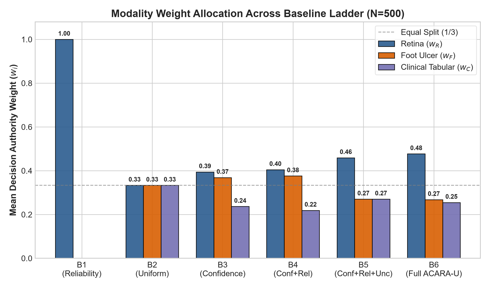
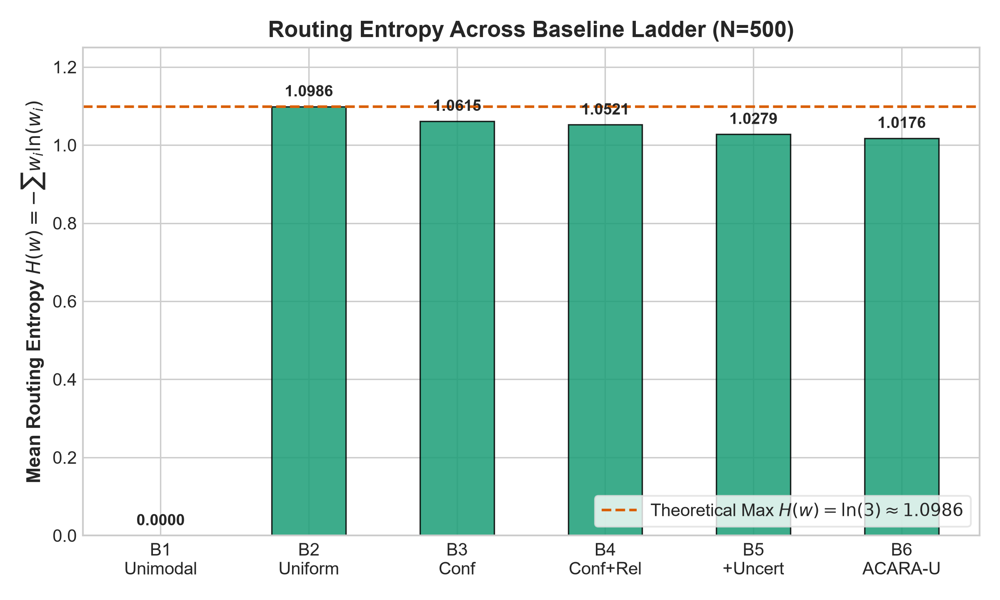
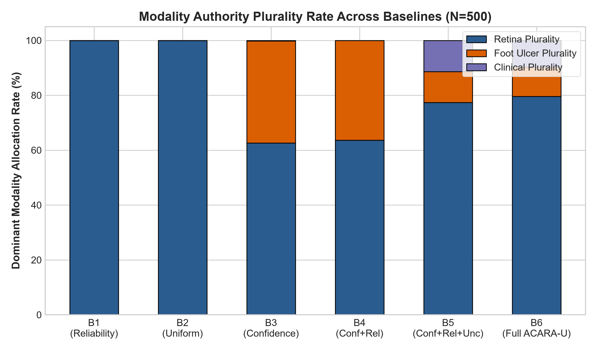
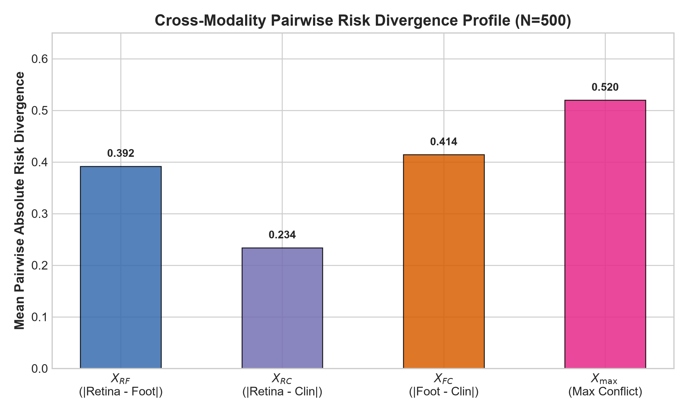

# Empirical Benchmark Results & Comparative Findings

## Cohort-Level Comparative Results ($N = 500$ Controlled Decision Packets)

> [!IMPORTANT]
> **Scientific Scope & Evaluation Interpretation**:
> Phase C11.5 evaluates routing behavior, authority allocation, and robustness across the baseline ladder (B1–B6), **not** the predictive superiority of multimodal fusion. Active clinical orchestration via `EvidenceOrchestrator` preserves each modality's native `ModalityPrediction` in `EvidenceReport` (`common_target_prediction = None`), while the reported fusion quantities ($R_{\text{fusion}} = \sum w_i r_i$) are evaluated inside `ResearchFusionIndex` under controlled modality-availability conditions.
> ACARA-U assigned the largest mean routing authority ($42.87\%$ under $\Theta_{\text{unit}}$, $42.71\%$ under $\Theta_0$) to Retina in the evaluated cohort due to its higher frozen reliability prior ($R_R=0.930$) and low observed uncertainty, with Clinical receiving $35.19\%$ ($\Theta_{\text{unit}}$) / $34.98\%$ ($\Theta_0$) and Foot receiving $21.94\%$ ($\Theta_{\text{unit}}$) / $22.31\%$ ($\Theta_0$).

The empirical benchmark was executed using PRNG seed $115$ over $N = 500$ decision packets constructed from held-out validation prediction pools ($N_R = 366, N_F = 1006, N_C = 14911$) through `RetinaAdapter`, `FootAdapter`, and `ClinicalAdapter`.

### 1. Full Tri-Modal Benchmark Summary (Config 1: All Available, $\Theta_{\text{unit}}$ & $\Theta_0$)

| Baseline ID | Name | Formula / Scoring Rule | Mean $w_R$ | Mean $w_F$ | Mean $w_C$ | Mean $\overline{R}_{\mathrm{fusion}}$ | Mean Routing Entropy $H(w)$ | Dominant Modality Distribution |
| :--- | :--- | :--- | :---: | :---: | :---: | :---: | :---: | :--- |
| **B1** | Reliability-Selected | $\arg\max R_i$ ($R_R > R_F > R_C$) | $1.0000$ | $0.0000$ | $0.0000$ | $0.255037$ | $0.0000$ | Retina: $100.0\%$, Foot: $0.0\%$, Clin: $0.0\%$ |
| **B2** | Uniform Average | $w_i = 1/3$ | $0.3333$ | $0.3333$ | $0.3333$ | $0.296804$ | $1.0986$ | Equal ($33.3\%$ each) |
| **B3** | Confidence-Only | $z_i = 1.0 \times C_i$ | $0.3368$ | $0.3145$ | $0.3487$ | $0.282063$ | $1.0784$ | Retina: $32.8\%$, Foot: $29.0\%$, Clin: $38.2\%$ |
| **B4** | Conf + Reliability | $z_i = 1.0 \times C_i + 1.0 \times R_i$ | $0.3496$ | $0.3241$ | $0.3263$ | $0.287679$ | $1.0793$ | Retina: $38.4\%$, Foot: $31.6\%$, Clin: $30.0\%$ |
| **B5** | Conf + Rel + Uncert | $z_i = C_i + R_i - U_i$ | $0.4094$ | $0.2199$ | $0.3707$ | $0.257236$ | $1.0446$ | Retina: $63.8\%$, Foot: $5.6\%$, Clin: $30.6\%$ |
| **B6 ($\Theta_{\text{unit}}$)** | Full ACARA-U ($\Theta_{\text{unit}}$) | $z_i = C_i + R_i - U_i + Q_i$ | $0.4287$ | $0.2194$ | $0.3519$ | $0.259623$ | $1.0371$ | Retina: $73.4\%$, Foot: $4.6\%$, Clin: $22.0\%$ |
| **B6 ($\Theta_0$)** | Full ACARA-U ($\Theta_0$) | $z_i = C_i + 1.5 R_i - U_i + 0.5 Q_i$ | $0.4271$ | $0.2231$ | $0.3498$ | $0.261017$ | $1.0390$ | Retina: $73.2\%$, Foot: $4.8\%$, Clin: $22.0\%$ |

---

## Key Ablation & Comparative Observations

1. **Impact of Global Reliability Prior (B3 $\to$ B4)**:
   Adding historical validation reliability ($R_i$) boosts Retina mean authority from $0.3368$ to $0.3496$ and dominant rate from $32.8\%$ to $38.4\%$, reflecting the higher frozen global reliability prior assigned to Retina in C11.3 ($R_R = 0.930$ vs $R_C = 0.825$).
2. **Impact of Predictive Uncertainty Penalty (B4 $\to$ B5)**:
   Adding $-1.0 \times U_i$ substantially alters authority allocation. Foot ulcer entropy-based uncertainty ($U_F = 0.3712$) downweights Foot from $32.41\%$ mean weight to $21.99\%$, reallocating authority toward lower-uncertainty Retina ($40.94\%$) and Clinical ($37.07\%$) assessments.
3. **Impact of Input Quality Metric (B5 $\to$ B6)**:
   The quality term incorporates modality-specific input-quality information (physical sharpness/illumination $Q_R$, boundary clarity $Q_F$, and feature completeness $Q_C$) into routing authority. In the evaluated cohort, mean Retina weight settles at $0.4287$ ($0.4271$ under $\Theta_0$), Foot at $0.2194$ ($0.2231$ under $\Theta_0$), and Clinical at $0.3519$ ($0.3498$ under $\Theta_0$), with an observed mean routing entropy of $1.0371\text{ nats}$ ($1.0390\text{ nats}$ under $\Theta_0$).

---

## Cross-Modality Disagreement Metrics ($N = 500$)

Across the tri-modal cohort, the mean pairwise risk divergences were:
- $\text{Mean } X_{RF} = 0.355849$
- $\text{Mean } X_{RC} = 0.251225$
- $\text{Mean } X_{FC} = 0.433588$
- $\text{Mean } \Delta_{\text{mean}} = 0.346887$, $\text{Mean } \Delta_{\max} = 0.520331 \pm 0.257113$

These results show substantial pairwise risk divergence within the controlled evaluation cohort and motivate the evaluation of explicit conflict analysis in the subsequent DCRI phase.

