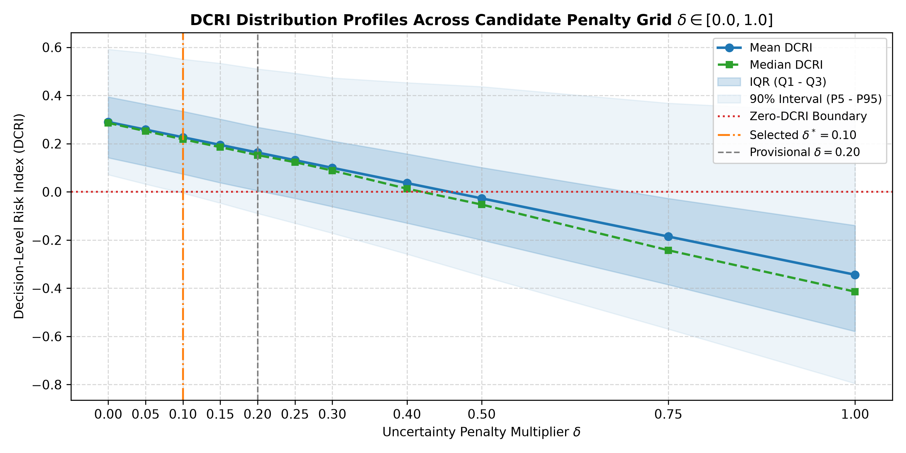
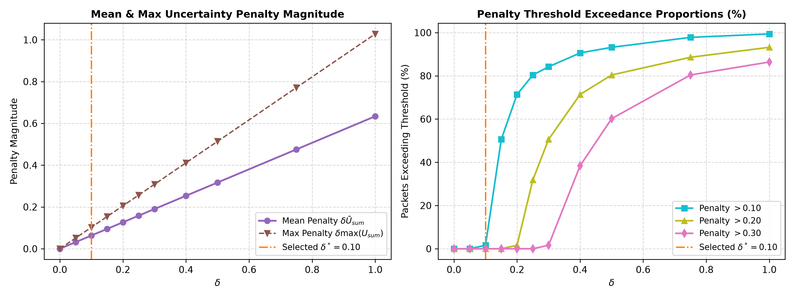

# Chapter 03 — Full Empirical Cohort Results

## 1. Primary Empirical Evaluation Table

Evaluated over the complete $N=500$ controlled decision cohort (seed 115) under reference router configuration $\Theta_0 = (1.0, 1.5, 1.0, 0.5)$:

| ID | $\delta$ | Mean DCRI | Negative Rate | Mean Penalty $\overline{P}$ | Penalty / Base | Max Penalty | Spearman $\rho_s$ |
| :--- | :---: | :---: | :---: | :---: | :---: | :---: | :---: |
| **D00** | $0.00$ | $0.261017$ | $0.0\%$ (0/500) | $0.000000$ | $0.00\%$ | $0.000000$ | $1.000000$ |
| **D05** | $0.05$ | $0.229320$ | $0.0\%$ (0/500) | $0.031697$ | $12.14\%$ | $0.051404$ | $0.996602$ |
| **D10** | **$0.10$** | **$0.197624$** | **$7.6\%$ (38/500)** | **$0.063394$** | **$24.29\%$** | **$0.102808$** | **$0.987239$** |
| **D15** | $0.15$ | $0.165927$ | $18.6\%$ (93/500) | $0.095090$ | $36.43\%$ | $0.154212$ | $0.972781$ |
| **D20** | $0.20$ | $0.134230$ | $25.4\%$ (127/500) | $0.126787$ | $48.57\%$ | $0.205616$ | $0.955973$ |
| **D25** | $0.25$ | $0.102533$ | $30.8\%$ (154/500) | $0.158484$ | $60.72\%$ | $0.257020$ | $0.936675$ |
| **D30** | $0.30$ | $0.070836$ | $39.2\%$ (196/500) | $0.190181$ | $72.86\%$ | $0.308423$ | $0.916076$ |
| **D40** | $0.40$ | $0.007443$ | $55.6\%$ (278/500) | $0.253574$ | $97.15\%$ | $0.411231$ | $0.871336$ |
| **D50** | $0.50$ | $-0.055951$ | $67.4\%$ (337/500) | $0.316968$ | $121.44\%$ | $0.514039$ | $0.825694$ |
| **D75** | $0.75$ | $-0.214435$ | $79.6\%$ (398/500) | $0.475452$ | $182.15\%$ | $0.771059$ | $0.725490$ |
| **D100** | $1.00$ | $-0.372919$ | $84.2\%$ (421/500) | $0.633936$ | $242.87\%$ | $1.028078$ | $0.648783$ |

### Figure 1: DCRI Score Distributions Across Candidate Grid ($\delta \in [0.0, 1.0]$)

---

## 2. Penalty Magnitude Dynamics & Threshold Exceedance

Because the penalty term $\Delta \text{DCRI}_\delta = -\delta U_{\text{sum}}$ scales directly with aggregate modality uncertainty, we examine the proportion of packets where the uncertainty penalty exceeds operational clinical relevance thresholds:

| ID | $\delta$ | Penalty $> 0.10$ | Penalty $> 0.20$ | Penalty $> 0.30$ | Maximum Observed Penalty |
| :--- | :---: | :---: | :---: | :---: | :---: |
| **D00** | $0.00$ | $0.0\%$ (0) | $0.0\%$ (0) | $0.0\%$ (0) | $0.000000$ |
| **D05** | $0.05$ | $0.0\%$ (0) | $0.0\%$ (0) | $0.0\%$ (0) | $0.051404$ |
| **D10** | **$0.10$** | **$1.6\%$ (8)** | **$0.0\%$ (0)** | **$0.0\%$ (0)** | **$0.102808$** |
| **D15** | $0.15$ | $50.6\%$ (253) | $0.0\%$ (0) | $0.0\%$ (0) | $0.154212$ |
| **D20** | $0.20$ | $71.4\%$ (357) | $1.6\%$ (8) | $0.0\%$ (0) | $0.205616$ |
| **D25** | $0.25$ | $80.4\%$ (402) | $31.8\%$ (159) | $0.0\%$ (0) | $0.257020$ |
| **D30** | $0.30$ | $84.2\%$ (421) | $50.6\%$ (253) | $1.6\%$ (8) | $0.308423$ |
| **D40** | $0.40$ | $90.6\%$ (453) | $71.4\%$ (357) | $38.4\%$ (192) | $0.411231$ |
| **D50** | $0.50$ | $93.2\%$ (466) | $80.4\%$ (402) | $60.2\%$ (301) | $0.514039$ |
| **D75** | $0.75$ | $97.8\%$ (489) | $88.6\%$ (443) | $80.4\%$ (402) | $0.771059$ |
| **D100** | $1.00$ | $99.4\%$ (497) | $93.2\%$ (466) | $86.4\%$ (432) | $1.028078$ |

### Figure 2: Uncertainty Penalty Scaling & Threshold Exceedance Proportions

### Key Diagnostic Observations:
- **$\delta = 0.10$ Threshold Containment**: At $\delta = 0.10$, only $1.6\%$ of encounters experience a penalty exceeding $0.10$, ensuring that uncertainty acts as a measured discount rather than completely overwhelming the underlying risk evidence.
- **$\delta = 0.20$ Penalty Escalation**: At the historical $\delta = 0.20$, over **$71.4\%$** of packets receive a penalty $> 0.10$, creating heavy compression across the lower risk quartiles.
