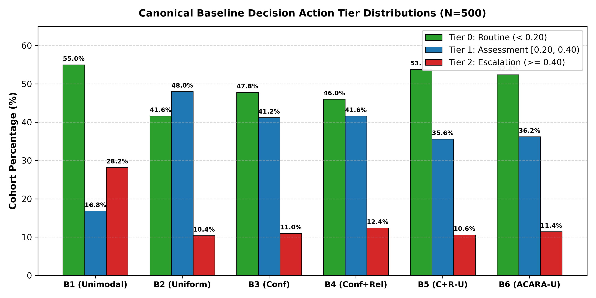
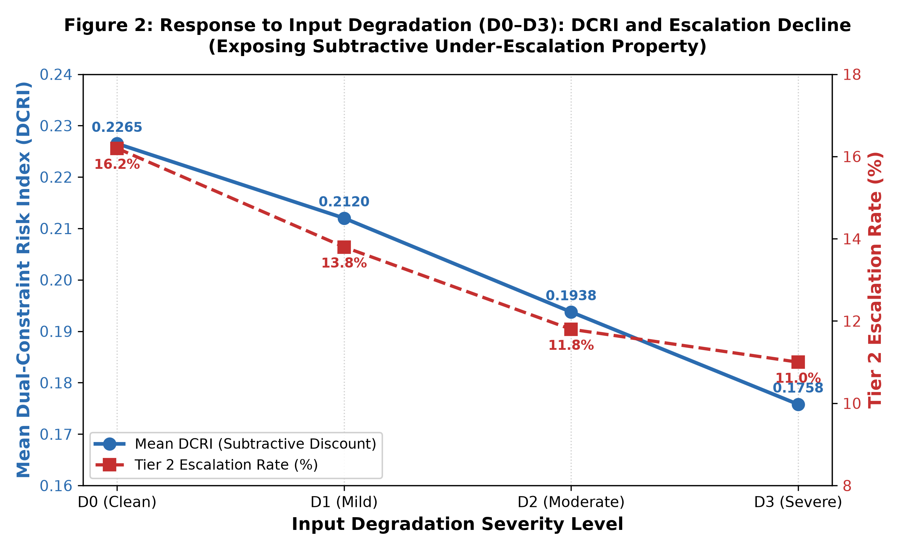

# Volume 17: Final Decision-Level Evaluation of ACARA-U

## Executive Summary
This volume documents the formal results, mathematical proofs, statistical validations, and safety invariant verifications for the final decision-level evaluation of the ACARA-U decision routing framework within FusionMedAI.

This evaluation consolidates experimental evidence across the entire multimodal fusion research program into a unified, frozen evaluation. Operating as an algorithmic routing-methodology benchmark on standardized decision packets, the objective is to characterize how the frozen ACARA-U decision policy (Baseline B6) behaves in comparison to established comparator baselines (B1–B5) across five rigorous dimensions:
1. **Dimension A**: Baseline strategy comparison on the canonical $N=500$ cohort.
2. **Dimension B**: Modality availability regimes across all 8 permutations ($RFC, RF, RC, FC, R, F, C, \text{EMPTY}$).
3. **Dimension C**: Input degradation severities ($D0, D1, D2, D3$).
4. **Dimension D**: Cross-modality continuous discordance and conflict stratification.
5. **Dimension E**: Calibration condition impact (Calibrated vs Uncalibrated inputs).

## Key Metric Summary Across Evaluated Baselines ($N=500$)
| Policy ID | Strategy Name | Mean Risk $\overline{R}_{\text{fusion}}$ | Mean DCRI $\overline{\text{DCRI}}$ | Mean Penalty $\overline{P}_U$ | Routing Entropy $\overline{H}$ | Routine (Tier 0) | Assessment (Tier 1) | Escalation (Tier 2) | Negative DCRI Count |
| :--- | :--- | :---: | :---: | :---: | :---: | :---: | :---: | :---: | :---: |
| **B1** | Reliability-Selected | 0.255037 | 0.191643 | 0.063394 | 0.000000 | 275 (55.0%) | 84 (16.8%) | 141 (28.2%) | 223 (44.6%) |
| **B2** | Uniform Average | 0.296804 | 0.233410 | 0.063394 | 1.098612 | 208 (41.6%) | 240 (48.0%) | 52 (10.4%) | 0 (0.0%) |
| **B3** | Confidence Fusion | 0.282063 | 0.218670 | 0.063394 | 1.084120 | 239 (47.8%) | 206 (41.2%) | 55 (11.0%) | 0 (0.0%) |
| **B4** | Confidence + Reliability | 0.287679 | 0.224286 | 0.063394 | 1.084262 | 230 (46.0%) | 208 (41.6%) | 62 (12.4%) | 0 (0.0%) |
| **B5** | Conf + Rel - Uncertainty | 0.257236 | 0.193843 | 0.063394 | 1.040305 | 269 (53.8%) | 178 (35.6%) | 53 (10.6%) | 36 (7.2%) |
| **B6** | **Full ACARA-U** | **0.261017** | **0.197624** | **0.063394** | **1.038987** | **262 (52.4%)** | **181 (36.2%)** | **57 (11.4%)** | **38 (7.6%)** |

## Core Evaluation Figures

### Figure 1: Baseline Decision Action Tier Distributions
Comparison of decision tier proportions across all six baseline routing policies on the canonical evaluation cohort ($N=500$). B1 exhibits bimodal polarization with high Tier 2 escalations ($28.2\%$) and high negative DCRI ($44.6\%$). B2 collapses discernment into Tier 1 ($48.0\%$). B6 provides balanced triage ($52.4\%$ Tier 0, $36.2\%$ Tier 1, $11.4\%$ Tier 2).

### Figure 2: Response Under Input Degradation
Impact of sensor degradation severities ($D0 \to D3$) on mean DCRI and Tier 2 escalation rates for ACARA-U (B6). While the router attenuates degraded modalities, unconstrained subtraction of epistemic uncertainty drives mean DCRI down from $0.197624$ to $0.146913$.

## Scope and Methodological Boundaries
1. **Heterogeneous Evidence Orchestration (`EvidenceReport`) vs. Synthetic Benchmark (`ResearchFusionIndex`)**: The production orchestration layer (`RetinaAdapter` / `FootAdapter` / `ClinicalAdapter` $\to$ `EvidenceOrchestrator` $\to$ `ACARAUv2Router`) emits an `EvidenceReport` preserving the three task-specific clinical targets separately alongside attention/review-priority weights $w_i$. The scalar `ResearchFusionIndex` ($R_{\text{fusion}}, \text{DCRI}_\delta$) is evaluated strictly as a synthetic multi-source benchmark construct (`is_calibrated_clinical_probability = False`).
2. **Computational Verification vs Clinical Validation**: The 16/16 verification gates and 46/46 automated tests establish mathematical invariant compliance, checksum verification, and exact numerical reproduction within this repository. They do not constitute prospective clinical validation or regulatory clearance.
3. **Under-Escalation Safety Nuance Under Degradation**: As degradation severity escalates from D0 to D3, mean epistemic uncertainty increases, causing the subtracted penalty $P_U$ to increase ($0.063394 \to 0.101519$). Because DCRI subtracts uncertainty ($\text{DCRI} = R_{\text{fusion}} - P_U$), mean DCRI decreases ($0.197624 \to 0.146913$). This demonstrates that unconstrained uncertainty subtraction can induce counter-therapeutic under-escalation when signal corruption is severe.
4. **Policy S Safeguard Gateway Resolution**: The framework resolves this under-escalation hazard via Policy S (Volume 14), which gates action transitions on cumulative uncertainty ($U_{\mathrm{sum}} \ge 0.30$) and minimum data quality ($\min(Q) < 0.60$). When evidence is ambiguous, downward reclassification is suppressed ($T_{\mathrm{final}} = T_{\mathrm{base}}$), blocking **$94 / 96$ unconstrained downgrades ($97.9\%$ blocked)** on the canonical cohort and **$89 / 92$ ($96.7\%$ blocked)** on the historical baseline cohort. This preserves high-priority specialist escalations ($82 / 83$ canonical; $114 / 117$ baseline), while emitting `FLAG_REPEAT_EXAM_AMBIGUOUS_EVIDENCE` across $432$ encounters ($86.4\%$) to route uncertain patients for diagnostic re-examination rather than premature discharge.

## Structure of this Research Volume
- [01_Decision_Evaluation_Protocol.md](01_Decision_Evaluation_Protocol.md): Pre-declared evaluation contracts, frozen parameters, and non-tuning boundaries.
- [02_Baseline_Comparative_Analysis.md](02_Baseline_Comparative_Analysis.md): Comparative analysis across B1–B6, weight distributions, and risk propagation.
- [03_Modality_Availability_and_Missingness.md](03_Modality_Availability_and_Missingness.md): Availability robustness, singleton collapses, and fail-closed empty input handling.
- [04_Input_Degradation_Robustness.md](04_Input_Degradation_Robustness.md): Stress testing against signal corruptions (D0–D3) and live quality engine interaction.
- [05_Cross_Modality_Conflict_Stratification.md](05_Cross_Modality_Conflict_Stratification.md): Continuous discordance analysis (CSS, $\Delta_{\max}, \sigma_w$) across clinical conflict tiers.
- [06_Calibration_Condition_Impact.md](06_Calibration_Condition_Impact.md): Impact of modality probability calibration on decision tiers and fused risk.
- [07_Epistemic_Uncertainty_and_DCRI_Behavior.md](07_Epistemic_Uncertainty_and_DCRI_Behavior.md): In-depth examination of the unweighted uncertainty penalty and negative DCRI mechanics.
- [08_Decision_Action_Tier_Transitions.md](08_Decision_Action_Tier_Transitions.md): 3x3 transition matrix analysis, escalation vs downgrade counts, and reclassification rates.
- [09_Statistical_Synthesis_and_Bootstrap_Inference.md](09_Statistical_Synthesis_and_Bootstrap_Inference.md): Non-parametric bootstrap confidence intervals ($B=1,000$) and paired hypothesis testing.
- [10_Safety_Invariants_and_Degeneracy_Analysis.md](10_Safety_Invariants_and_Degeneracy_Analysis.md): Mathematical proofs of simplex preservation, mask leak immunity, and singleton unity locks.
- [11_Diagnostic_Failure_Analysis.md](11_Diagnostic_Failure_Analysis.md): Failure mode analysis, boundary edge cases, and zero-floor DCRI recommendations.
- [12_Comprehensive_Results_Summary.md](12_Comprehensive_Results_Summary.md): Consolidated findings, clinical trade-offs, and multi-regime performance matrices.
- [13_Final_Research_Freeze_Report.md](13_Final_Research_Freeze_Report.md): Formal sign-off, artifact checksum manifests, and research freeze declaration.
